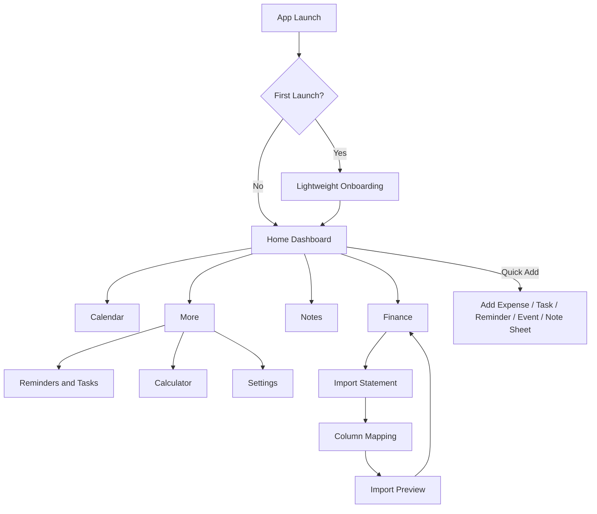
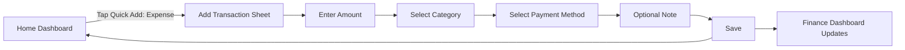
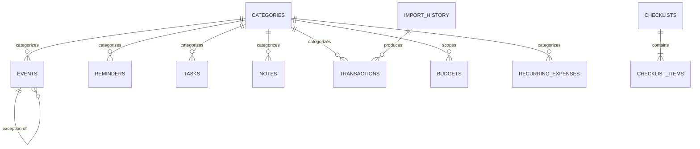
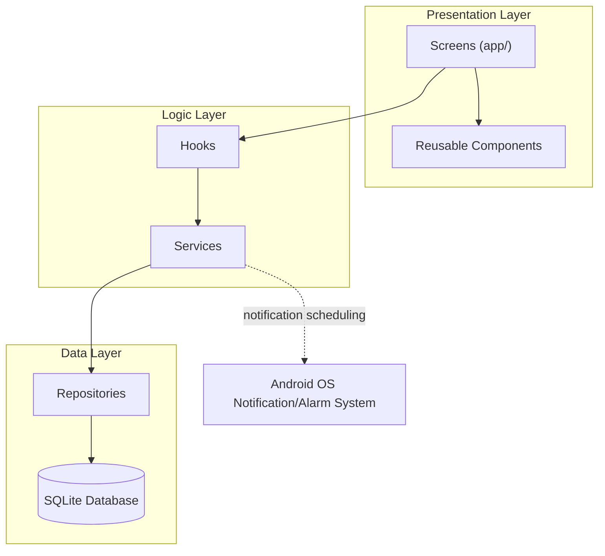
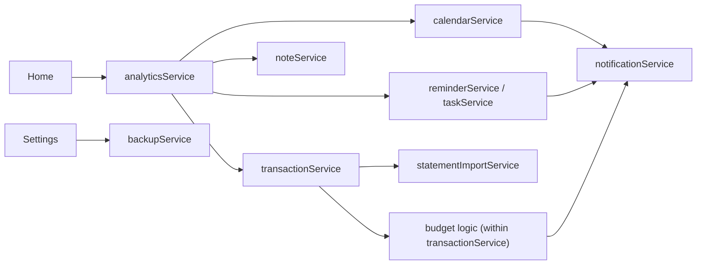
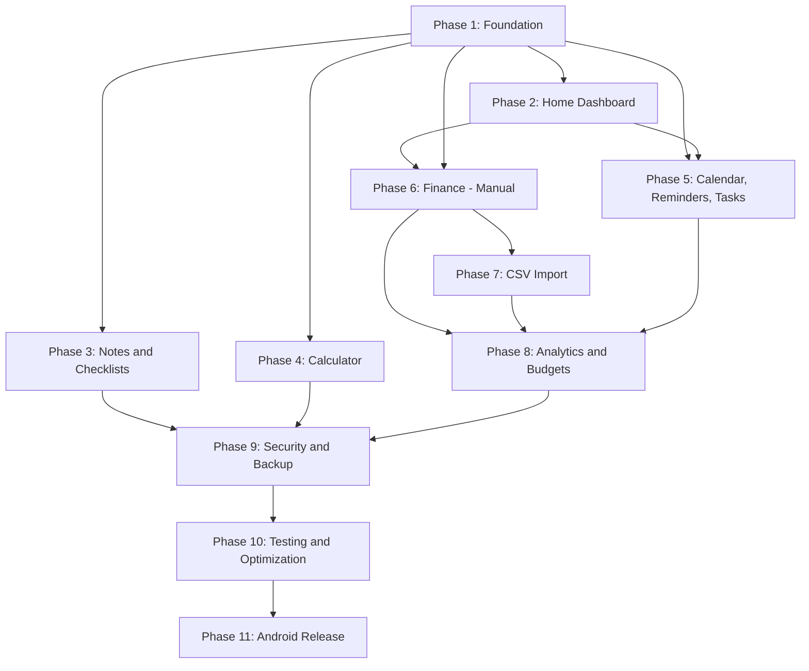

# LIFORA
### Your everyday life, organized.

**Product Requirements Document**
Version 1.0 · Draft for Review · 2026-11-06

---

## Document Control

| Field | Value |
|---|---|
| Document Title | LIFORA Complete Product Requirements Document |
| Version | 1.0 |
| Status | Draft — Pending Stakeholder Review |
| Prepared For | LIFORA V1 Android Application |
| Prepared Using | Product strategy, mobile architecture, UI/UX, database design, and engineering analysis |
| Scope | V1 (offline-first Android release) with V1.1 and V2 forward-looking notes |
| Distribution | Internal — product owner and development team |

**Important notice:** This document is planning and specification material only. No application code has been written as part of producing this PRD. Implementation begins only after this document is reviewed and approved.

---

# Table of Contents

*(Auto-generated in the PDF edition with page numbers. Section list below mirrors the PDF table of contents.)*

1. Official Application Identity
2. Problem Statement
3. Target Users
4. Complete Functional Requirements
5. UI/UX Design Requirements
6. Technology Stack
7. Offline-First Architecture
8. Database Architecture
9. Application Architecture
10. Complete Project Folder Structure
11. Security and Privacy
12. Future Enhancements
13. Testing Strategy
14. Development Roadmap
15. Android Build and Publishing
16. Non-Functional Requirements
17. Technical Risks and Assumptions
18. Documentation and PDF Requirements
19. Important Development Guidelines
20. Final Deliverable Verification
21. Glossary

---

# 1. Official Application Identity

**Application Name:** LIFORA

**Tagline:** Your everyday life, organized.

**Product Category:** All-in-one personal life management and productivity application.

**Platform:** Android smartphones (Android 8.0 / API 26 and above, recommended baseline — see Section 16 for the final compatibility target).

**Development Approach:** Offline-first. The application must be fully usable with no network connection for every V1 feature.

## 1.1 Product Vision

LIFORA is an all-in-one personal life management application designed to solve a common everyday problem: people depend on a patchwork of separate applications to manage different aspects of their lives. One application is used for calendars, another for reminders, another for expenses, another for notes, and another for quick calculations. Switching between these tools breaks concentration, scatters information, and makes it hard to see the whole picture of a day, a week, or a month.

LIFORA brings these essential everyday tools into one organized, convenient, and easy-to-use application. It helps users manage their time, responsibilities, finances, personal information, and daily activities from a single place. The application is designed to feel like a personal digital companion — quietly present, dependable, and tailored to the rhythm of the user's day — rather than another productivity tool competing for attention.

## 1.2 Core Value Proposition

**Everything needed to organize everyday life, in one place.**

LIFORA prioritizes, in order:

1. **Simplicity** — every screen does one job well, with minimal cognitive load.
2. **Convenience** — frequent actions (add expense, add reminder, add note) are never more than two taps from Home.
3. **Reliability** — data is never lost, calculations are always correct, and reminders fire as promised, within the real constraints of Android (see Module 3 and Section 16).
4. **Accessibility** — readable type, sufficient contrast, and forgiving touch targets for users of all ages and technical backgrounds.
5. **Consistency** — the same visual language, interaction patterns, and terminology across every module, so a user who learns one part of LIFORA already knows how to use the rest.

## 1.3 What LIFORA Is Not (V1 Scope Boundary)

To keep the vision honest and implementable, V1 explicitly excludes:

- Cloud accounts, sign-up/login flows, or server-hosted user data.
- Automatic bank or UPI-app synchronization of any kind.
- Multi-device sync.
- Social or sharing features.
- AI-generated financial advice.

These exclusions are deliberate, not omissions — they are revisited in Section 12 (Future Enhancements).

---

# 2. Problem Statement

## 2.1 The Fragmentation Problem

Most people manage daily life using five to ten disconnected applications: a calendar app, a to-do app, a notes app, one or two finance/expense trackers, a separate calculator, and often a dedicated app just for reminders. Each of these tools is well-built in isolation, but together they create friction that compounds over a week, a month, and a year.

Specifically, users experience:

- **Context switching cost.** Checking "what do I need to do today" requires opening three or four apps in sequence — calendar for events, a to-do app for tasks, a reminder app for alerts, and a finance app to check if a bill is due. Each switch costs attention and often ends with the user forgetting why they opened the next app.
- **Difficulty tracking daily schedules and responsibilities.** Without one place that merges events, tasks, and reminders, users rely on memory or scattered sticky notes, and small responsibilities quietly fall through the cracks.
- **Missed reminders and deadlines.** When reminders live in a different app from the calendar and the task list, there is no single surface that surfaces "what is coming up" — so time-sensitive items get missed, not because the user doesn't care, but because no view shows everything at once.
- **No consolidated view of personal finances.** Expense tracking apps rarely show the full financial picture (income, spending, and remaining budget) in a way that connects to the rest of the user's day. People default to mental math or a notes app, which drifts out of date quickly.
- **Difficulty understanding spending patterns.** Even when expenses are logged, raw transaction lists without categorization and trend analysis don't answer the question users actually have: "where is my money going, and is that a problem?"
- **Scattered notes and checklists.** Shopping lists, packing lists, and quick ideas end up split across a notes app, a messaging app "notes to self" thread, and paper — with no reliable single source of truth.
- **Separate apps for simple calculations.** EMI estimates, GST calculations, and bill-splitting are common everyday needs that currently require searching for, downloading, and learning a new single-purpose app each time.
- **No integration between everyday tools.** Because none of these apps talk to each other, there is no dashboard that shows "today" across every dimension of personal life at once.

## 2.2 How LIFORA Addresses These Problems

LIFORA responds to fragmentation with **consolidation without complexity**:

| Problem | LIFORA's Response |
|---|---|
| Context switching across apps | A single Home Dashboard surfaces today's events, tasks, reminders, and spending in one screen |
| Scattered schedule and responsibilities | Calendar, Reminders, and Tasks share one underlying data model and are cross-referenced from Home |
| Missed reminders/deadlines | A unified upcoming-items view across calendar, reminders, and tasks, backed by local notification scheduling |
| No consolidated finance view | A dedicated Finance module with dashboard, manual entry, CSV import, categorization, analytics, and budgets |
| Unclear spending patterns | Category-wise and trend analytics built directly from the same transaction data entered or imported |
| Scattered notes/checklists | A single Notes and Checklists module with search, pinning, and templates |
| Separate calculator apps | A built-in calculator plus EMI, GST, discount, and split-bill calculators |
| No integration | One local database, one design system, one navigation structure — every module is a view onto the same underlying life data |

LIFORA does not attempt to replace specialized professional tools (accounting software, enterprise calendars). It targets the everyday personal layer that most people currently manage with a disorganized mix of five or more general-purpose apps.

---

# 3. Target Users

## 3.1 Primary Audience Segments

- **College students** — juggling class schedules, assignment deadlines, limited and irregular income, and a need for simple budgeting.
- **Working professionals** — managing meetings, bill payments, salary-based budgeting, and personal errands alongside work obligations.
- **Freelancers** — irregular income streams, project deadlines, and a need to track business versus personal expenses without full accounting software.
- **Individuals managing personal finances** — users who currently track spending manually (notebook, spreadsheet, or nothing at all) and want a lightweight, private, local tool.
- **People who want to organize everyday activities** — users without a strong existing system who are looking for one simple place to start.
- **Users who prefer a single application over many** — people actively fatigued by app-switching and willing to consolidate even at the cost of some specialized features.

## 3.2 User Personas

### Persona 1 — Ananya, the College Student
- **Age:** 20. **Occupation:** Final-year engineering student.
- **Context:** Manages class timetables, assignment deadlines, a part-time tutoring income, and a tight monthly allowance from parents plus tutoring income.
- **Needs:** A single place to see today's classes and deadlines; a simple way to track where her limited money goes; checklists for exam preparation and project submissions.
- **Expectations:** Fast entry (she is often between classes), works without mobile data (campus Wi-Fi is unreliable), visually calming (not another "corporate" productivity tool).
- **Frustration today:** Uses her phone's default calendar for classes, a notes app for assignments, and nothing for money — she "just hopes" she doesn't overspend before the next allowance.

### Persona 2 — Rohit, the Working Professional
- **Age:** 29. **Occupation:** Mid-level software engineer at a mid-size company.
- **Context:** Full calendar of meetings, salary-based monthly budget, recurring bills (rent, internet, subscriptions), and a habit of using UPI apps for most payments.
- **Needs:** Meeting and personal-event tracking in one calendar; a finance view that reconciles against his bank statement without manual re-typing every transaction; reminders for bill due dates.
- **Expectations:** Reliable notifications, CSV import from his bank's net-banking export, clear monthly spending breakdown by category, a budgeting feature that warns him before he overspends.
- **Frustration today:** Uses Google Calendar for meetings, a separate expense app that requires manual entry of every UPI transaction (which he has stopped doing consistently), and a sticky note for recurring bill dates.

### Persona 3 — Meera, the Freelancer
- **Age:** 26. **Occupation:** Freelance graphic designer.
- **Context:** Irregular project-based income, multiple client deadlines, mixed personal and freelance expenses, no fixed monthly salary.
- **Needs:** Deadline tracking per project, income logging per client/payment, a clear monthly net cash-flow view since income is irregular, notes for client briefs.
- **Expectations:** Flexible categorization (business income vs. personal), ability to tag transactions with notes, a dashboard that doesn't assume a fixed salary pattern.
- **Frustration today:** Tracks client payments in a spreadsheet that she updates sporadically; deadlines live in WhatsApp chats and a paper planner.

### Persona 4 — Deepak, the Budget-Conscious Individual
- **Age:** 34. **Occupation:** Retail manager, primary earner for a small household.
- **Context:** Needs careful monthly budgeting across rent, groceries, utilities, and savings goals; wants to know, at a glance, how much of this month's budget remains.
- **Needs:** Category-wise budgets with progress indicators, recurring expense tracking for predictable monthly bills, simple reports he can trust.
- **Expectations:** No confusing jargon, large readable numbers, a currency that defaults correctly to INR, and a budget alert before he overspends a category.
- **Frustration today:** Uses a banking app's built-in (and limited) spend summary, which doesn't account for cash transactions at all.

## 3.3 User Needs Summary

- A single daily view of obligations (events, tasks, reminders).
- Confidence that nothing important will be silently missed.
- An honest, current picture of personal finances without manual re-entry of every transaction.
- A private place for notes and lists that doesn't require internet access.
- Quick utilities (calculator variants) without downloading more apps.
- A consistent, pleasant interface that respects their time.

## 3.4 Typical Use Cases

1. Opening the app each morning to see "what's today" across events, tasks, and reminders.
2. Logging a cash expense immediately after a purchase, in under 10 seconds.
3. Importing a month-end bank statement to catch up on transactions logged in bulk rather than one by one.
4. Setting a recurring reminder for a monthly bill and being notified a day before it is due.
5. Creating a shopping checklist before heading to the store and checking off items while there.
6. Using the EMI calculator before deciding on a purchase on credit.
7. Reviewing the monthly finance dashboard to see whether spending is trending over or under budget.
8. Jotting a quick note during a meeting and finding it later through search.

## 3.5 User Journeys

**Journey A — Daily Check-in (Ananya):**
Open app → Home Dashboard shows today's classes (Calendar), an assignment due tomorrow (Tasks), and ₹350 spent today (Finance) → taps "Add Expense" quick action after buying lunch → logs ₹120 under Food, Cash → returns to Home, dashboard updates instantly.

**Journey B — Month-End Reconciliation (Rohit):**
Downloads bank statement CSV from his bank's app → opens LIFORA Finance → Import Statement → selects file → LIFORA detects columns automatically → shows import preview with suggested categories → Rohit corrects two mis-categorized transactions → confirms import → Finance Dashboard and Analytics update with the full month's transactions.

**Journey C — Budget-Aware Spending (Deepak):**
Sets a monthly ₹8,000 grocery budget → logs grocery expenses throughout the month → receives an in-app indicator when he crosses 80% of the budget → adjusts spending for the rest of the month accordingly.

**Journey D — Deadline Management (Meera):**
Creates a calendar event "Client X — Logo Delivery" with a reminder two days prior → creates a checklist "Logo Deliverables" with the required file formats → checks items off as she completes them → marks the task complete once delivered and invoiced.

## 3.6 Functional User Scenarios

- A user with no internet connection (flight mode, rural signal) must be able to add a task, log an expense, and view all existing data without any degraded functionality.
- A user denies notification permission; the app must still function for all non-notification features and should clearly explain what will not work without that permission.
- A user imports a CSV with an unrecognized bank format; the app must ask for manual column mapping rather than silently misimporting data.
- A user with a large number of transactions (multiple years of history) must still experience responsive scrolling and search.

---

# 4. Complete Functional Requirements

Every module below is documented with feature descriptions, user actions, input fields, validation rules, business logic, data requirements, error handling, edge cases, dependencies, and acceptance criteria.

## Module 1: Home Dashboard

### 1.1 Feature Description
The Home Dashboard is the application's entry screen and single most-visited surface. It gives a time-aware, at-a-glance summary of the user's day across every module, and routes the user to deeper detail with one tap.

### 1.2 Dashboard Contents
- Current date and day of week, prominently displayed.
- Time-based personalized greeting ("Good morning", "Good afternoon", "Good evening", "Good night") derived from device local time.
- **Today's Events** card — events from Calendar scheduled for the current date, sorted by start time.
- **Upcoming Events** card — next 3–5 events beyond today, with date labels ("Tomorrow", "Fri, 14 Nov").
- **Pending Reminders** card — reminders due today or overdue, with a snooze/complete quick action.
- **Tasks** card — pending vs. completed counts for today and this week, with quick-complete checkboxes.
- **Today's Expenses** card — sum of today's transactions with a one-line category breakdown.
- **Monthly Spending Summary** card — month-to-date spend vs. the monthly budget (if set), shown as a progress indicator.
- **Income and Expense Overview** card — current month income, expenses, and net balance.
- **Quick-Access Calculator** — a compact calculator entry point (tap to expand to the full Calculator module).
- **Recent Notes** card — last 3 edited or pinned notes.
- **Quick-Add buttons** — floating or row of shortcuts: Add Event, Add Task, Add Reminder, Add Expense, Add Note.

### 1.3 User Actions
- Tap any card to navigate to its full module view.
- Tap a quick-add button to open the relevant creation screen pre-focused on the first input.
- Mark a reminder or task complete directly from its dashboard row.
- Pull to refresh (recomputes all summaries from the local database; mainly useful after a bulk import).
- Long-press a dashboard card (where supported) to reorder or hide it, if the user has enabled dashboard customization in Settings.

### 1.4 Business Logic
- "Today" is computed from device local date/time and updates automatically at midnight without requiring app restart (checked on resume and via a lightweight date-change listener).
- Cards reflect the live database state — if a transaction is added in Finance, the dashboard updates the next time it gains focus (no separate caching layer that can drift out of sync).
- Monthly budget progress is only shown if the user has configured at least one budget; otherwise the card shows an empty state inviting budget setup.
- Completed tasks/reminders remain visible with a struck-through style until the next day, then roll off the dashboard (they remain accessible in their respective modules).

### 1.5 Empty States
- No events today: "Nothing scheduled today — enjoy the calm, or tap + to plan ahead."
- No transactions this month: "No expenses logged yet this month."
- No notes: "Your notes will show up here once you create one."
Each empty state includes a direct call-to-action button into the relevant creation flow.

### 1.6 Data Requirements
Dashboard reads (does not duplicate) from: `events`, `reminders`, `tasks`, `transactions`, `budgets`, `notes`. No dashboard-specific table is required for V1; a lightweight in-memory aggregation is computed on screen load.

### 1.7 Error Handling and Edge Cases
- Database read failure on a single card must not crash the dashboard — that card shows a retry affordance while others render normally.
- A user with no data at all (first launch) sees a fully empty-state dashboard with onboarding hints, not a blank or broken screen.
- Very large data volumes (years of transactions) must not be fully loaded for the dashboard — only aggregate queries scoped to "today" and "this month" are run.

### 1.8 Dependencies
Calendar, Reminders, Tasks, Finance, and Notes modules must each expose a read query usable by the dashboard aggregation layer (see Section 9, Analytics/Dashboard service responsibilities).

### 1.9 Acceptance Criteria
- Given events exist today, When the user opens Home, Then today's events appear sorted by time within 500ms of screen load on a mid-range device.
- Given no reminders are pending, When the user opens Home, Then the Reminders card shows its empty state, not an error or blank space.
- Given the user completes a task from the dashboard, When they return to the Tasks module, Then the task reflects the same completed state (single source of truth, no sync lag).
- Given the device date rolls over past midnight while the app is open in the background, When the user resumes the app, Then "Today" reflects the new date without a restart.

---

## Module 2: Calendar

### 2.1 Feature Description
A fully local calendar for scheduling and viewing events, independent of the Android system calendar, with monthly, weekly, and daily views.

### 2.2 Features
- Monthly, weekly, and daily calendar views, switchable via a segmented control.
- Navigation between dates/months via swipe gestures and explicit next/previous controls.
- Current date highlighted distinctly in all views.
- Event indicator dots/bars on days containing events (monthly view).
- Create, edit, and delete events.
- Event fields: title (required), description (optional), start date/time (required), end date/time (required, must be ≥ start), location (optional), category (required, defaults to "Personal"), priority (Low/Medium/High), recurrence rule (optional).
- Recurring events: daily, weekly, monthly, yearly, with an end condition (never, on a date, after N occurrences).
- Search events by title/description/location.
- Upcoming events list (next 30 days), independent of the calendar grid, for fast scanning.

### 2.3 Event Categories
Personal, College, Work, Meetings, Birthdays, Other. Each category has a distinct color used consistently across calendar dots, event cards, and the dashboard.

### 2.4 Recurrence Logic
- A recurring event is stored once as a **recurrence template** (rule: frequency, interval, end condition) rather than as pre-generated individual rows for every future occurrence, to keep the database bounded.
- Occurrences are materialized on demand for the visible date range (e.g., the current month view) using the recurrence rule, following the same model as RFC 5545 (iCalendar) `RRULE` semantics at a simplified subset: `FREQ=DAILY|WEEKLY|MONTHLY|YEARLY`, `INTERVAL`, `COUNT` or `UNTIL`.
- Editing a single occurrence of a recurring event prompts the user to choose "This event" vs. "This and following events" vs. "All events in the series." V1 supports "This event only" (creates an exception record) and "All events" (edits the template); "This and following" is a V1.1 enhancement if time allows, and is documented as such rather than silently unsupported.
- Deleting a recurring event follows the same scope choice.

### 2.5 Device Calendar Integration
LIFORA maintains its own local calendar and does not require access to the Android device calendar for any V1 functionality. Optional one-way export of LIFORA events to the device calendar may be considered as a V1.1 convenience feature (see Section 12) but is not implemented in V1, and the app never reads the device calendar without explicit, separately granted permission in that future phase.

### 2.6 Notification Integration
Each event may optionally schedule a local notification (e.g., 10 minutes before, 1 hour before, 1 day before, or a custom offset). Scheduling uses the same notification service documented in Module 3 and Section 16, with the same platform limitations disclosed there.

### 2.7 Validation Rules
- Title is required, 1–120 characters.
- End date/time must not be before start date/time; if a user sets an end before the start, the field shows an inline error and blocks saving.
- Recurrence `UNTIL` date must be after the event's start date.
- Category must be one of the defined set (or a user-defined custom category, if custom categories are enabled — see Section 12 for whether this ships in V1 or V1.1; assumption: V1 ships the fixed list only, custom categories are V1.1).

### 2.8 Error Handling and Edge Cases
- Overlapping events are allowed (the app does not block double-booking) but are visually stacked/indicated in day and week views.
- An event spanning multiple days (e.g., a multi-day trip) displays as a banner across the affected days in monthly/weekly views.
- Deleting the last occurrence exception of a recurring series does not delete the template unless the user explicitly deletes the whole series.
- Time zone change on the device: event times are stored as explicit date-time plus the time zone in effect when created (see Section 8); on a time zone change, absolute instants remain correct, but the UI clearly indicates if an event's wall-clock time shifted.

### 2.9 Dependencies
Calendar depends on the Notification Service (Section 9) for reminders and on the shared Category constants (Section 10) for consistent coloring with other modules.

### 2.10 Acceptance Criteria
- Given a recurring weekly event, When the user views any future month, Then all correctly-dated occurrences appear without requiring the user to have ever opened that month before.
- Given an event with a notification offset, When the scheduled time arrives and the app is closed, Then a local notification is delivered (subject to the Android constraints disclosed in Section 16).
- Given the user edits one occurrence of a recurring event and chooses "This event only," Then only that date reflects the change; other occurrences remain per the original rule.

---

## Module 3: Reminders and Task Management

### A. Reminders

**Features:** create, edit, delete reminders; title and description; date and time; priority (Low/Medium/High); category; recurrence (same simplified rule model as Calendar); snooze (preset intervals: 10 min, 1 hour, tomorrow, or custom); mark as completed; local notification delivery; per-reminder and global notification preferences.

**Validation:** title required (1–120 characters); date/time required and must be in the future at creation time (editing a past-due reminder to a new future time is allowed and reschedules its notification).

**Business logic:** completing a reminder cancels any pending notification for it. Snoozing reschedules the notification without altering the original due time shown in history. A recurring reminder generates its next occurrence's notification only after the current one is completed or its time has passed, to avoid stacking many future system alarms unnecessarily (see Section 16 for Android's limits on concurrent scheduled alarms).

### B. Tasks

**Features:** create, edit, delete tasks; deadlines (date, optional time); priority levels (Low/Medium/High); categories (shared category set with Calendar/Reminders for consistency); pending/completed status; filters (by category, priority, status, date range); sort by date or priority; search by title/description; completion tracking (completion timestamp retained for history/analytics).

**Validation:** title required (1–120 characters); deadline optional but if set must be a valid date; a task without a deadline is valid (treated as a standing to-do).

**Business logic:** tasks do not require a notification by default (unlike reminders) but may optionally have one attached, reusing the same scheduling path. Overdue tasks (deadline passed, not completed) are visually flagged and surfaced in a dedicated "Overdue" filter and on the Home Dashboard.

### C. Notifications — Shared Handling for Reminders and Tasks

LIFORA must correctly and transparently handle:

- **Notification permissions.** On Android 13+ (API 33+), POST_NOTIFICATIONS is a runtime permission. The app requests it contextually (the first time the user creates a reminder or enables a task notification), not at first launch, and explains why it is needed. If denied, reminders/tasks still save normally; the app shows a persistent but non-blocking banner explaining that alerts will not fire until the permission is granted, with a direct link to the app's notification settings.
- **Scheduling and cancellation.** Every create/edit/delete of a reminder, task notification, or event notification goes through a single Notification Service (Section 9) that owns scheduling, rescheduling, and cancellation, so there is one source of truth and no orphaned system alarms.
- **Rescheduling after edits.** Editing the date/time of a reminder/task/event cancels the previous scheduled notification and schedules a new one atomically.
- **Device restarts.** The app registers a `BOOT_COMPLETED` receiver (where the Expo/React Native notification library supports it, or via a native module if required) to re-register pending notifications after a device reboot, since Android clears exact alarms on restart. This is documented as a dependency to verify against the chosen Expo Notifications SDK version at implementation time (see Section 17, Risks).
- **Timezone changes.** Scheduled notifications are re-validated against the device's current timezone on app resume; if a timezone change would alter a notification's intended local-time meaning, the notification is rescheduled to preserve the user's original local-time intent.
- **Android notification channels.** Separate channels are created for Reminders, Tasks, Calendar Events, and Budget Alerts, each with user-configurable importance, so users can mute one category without muting all.
- **Exact alarm restrictions.** Starting with Android 12 (API 31), scheduling exact alarms requires the `SCHEDULE_EXACT_ALARM` permission (or use of `setAndAllowWhileIdle` variants), and Android 13+ allows users to revoke this permission at any time from system settings. LIFORA uses exact alarms where available and permitted, and falls back to inexact/best-effort delivery (via `setAndAllowWhileIdle` or the Expo Notifications scheduling API's default behavior) when exact alarms are not permitted, clearly stating in Settings that **delivery time may vary by a few minutes under battery optimization or Doze mode, and this is an Android platform behavior, not an application defect.** LIFORA does not promise exact-time delivery under all Android conditions, and the Settings → Notifications screen includes a short, honest explanation of this limitation.

### 3.1 Data Requirements
Reminders and Tasks are stored in separate tables (see Section 8) because their lifecycle and fields diverge (reminders are alert-centric; tasks are completion-centric), while sharing the same Category and Priority value sets for UI consistency.

### 3.2 Error Handling and Edge Cases
- Creating a reminder with a past date/time is blocked with a validation message ("Choose a time in the future").
- Snoozing a reminder that is also recurring snoozes only the current occurrence.
- If notification scheduling fails (e.g., permission revoked mid-session), the reminder/task still saves; the UI reflects that its alert is "Not scheduled" with a retry affordance.
- Bulk-deleting a category does not delete the reminders/tasks in it; it reassigns them to "Other" (explicit user confirmation required).

### 3.3 Acceptance Criteria
- Given notification permission is granted, When a reminder's time arrives, Then a notification is delivered within platform-typical latency, acknowledging Doze-mode variance.
- Given the device restarts with pending reminders, When the user next opens the app (or the boot receiver fires, if supported), Then previously scheduled reminders are still active.
- Given a task has no deadline, When the user filters tasks by "Overdue," Then that task is excluded (it cannot be overdue without a deadline).

---

## Module 4: Finance and Expense Management

Finance is the most complex module in LIFORA and receives the most detailed specification in this document.

### A. Finance Dashboard

**Displays:** total income (selected period), total expenses (selected period), net balance/cash flow, today's spending, this week's spending, this month's spending, category-wise expense breakdown (chart + list), recent transactions (last 5–10), budget usage (if budgets are configured), spending trend (simple line/bar over the last 6 months).

**Business logic:** all figures are computed live from the `transactions` table; nothing is pre-aggregated into a separate cache table in V1 (dataset sizes at the personal-finance scale do not require it — see Section 16 for the performance budget that justifies this).

### B. Transaction Management

**User actions:** add income; add expense; edit transaction; delete transaction (with confirmation); add a description; select a date (defaults to today); select a category; select a payment method; add an optional free-text note.

**Fields:** type (income/expense — required); amount (required, positive, stored as integer paise, see Section 4.H); date (required, defaults to today, cannot be set further than 1 day in the future to prevent accidental "planned" transactions being counted as actuals — planned/future transactions belong to Recurring Expenses, Section 4.G); category (required); payment method (required); description (optional, up to 200 characters); note (optional, up to 500 characters).

**Payment methods (labels only):** Google Pay, PhonePe, Paytm, Bank Transfer, Cash, Credit/Debit Card, Other. **These are transaction labels selected by the user for their own record-keeping. LIFORA does not integrate with, authenticate against, or read data from Google Pay, PhonePe, Paytm, or any bank or payment application. The user manually selects which label describes how a given transaction was made.**

**Validation rules:**
- Amount must be greater than zero; non-numeric input is rejected at the input layer (numeric keypad only).
- Amount is parsed and immediately converted to integer paise for storage (e.g., user enters "₹149.50" → stored as `14950`).
- Date must be a valid calendar date; future dates beyond +1 day are rejected with guidance to use Recurring Expenses instead.
- Category and payment method must be selected from the existing sets (custom categories can be added by the user, see Section 4.D).

### C. Bank Statement Import (CSV) — V1 Feature

This is a core, fully specified V1 workflow.

**Complete workflow:**

1. User selects a CSV file via the Android document picker (Expo Document Picker).
2. The file is read and parsed **entirely on-device**, using Papa Parse, with no network call of any kind.
3. LIFORA inspects the header row and attempts automatic column detection against a configurable set of known header aliases (see table below).
4. Required concepts to identify: transaction date, description/narration, and an amount representation (either a single signed "Amount" column, or separate Debit/Credit columns).
5. Optional concepts to identify, if present: running balance, reference/transaction ID.
6. If every required concept is confidently matched (exact or near-exact header match), LIFORA proceeds straight to the import preview (step 14).
7. If any required concept cannot be confidently matched, LIFORA presents a **Manual Column Mapping** screen: the raw CSV headers are listed, and the user assigns each required/optional concept to one of the CSV's columns via a dropdown, with a live preview of the first 5 rows reflecting the current mapping.
8. Once mapping is confirmed (automatically or manually), each row is normalized into a draft transaction: date parsed to ISO format, description trimmed, amount resolved to a signed integer-paise value (debit = negative/expense, credit = positive/income, or sign inferred from a single Amount column's own sign or from separate Debit/Credit columns).
9. LIFORA applies **Automatic Category Suggestion** (Section 4.D) to each draft transaction based on its description.
10. LIFORA runs **Duplicate Detection** (Section 4.C.3) against already-imported transactions.
11. Rows that fail normalization (unparseable date, non-numeric amount, completely empty required fields) are flagged as **Needs Review** rather than silently dropped or silently imported.
12. The **Import Preview** screen lists every draft transaction with its resolved date, description, amount, suggested category, payment method defaulted to "Bank Transfer" (user-editable), and a flag for suspected duplicates or rows needing review.
13. The user may edit any individual row inline (date, description, amount, category) before import.
14. The user selects which transactions to actually import via checkboxes (suspected duplicates default to **unchecked**; rows needing review default to **unchecked** until corrected).
15. The user confirms the import.
16. Confirmed transactions are written to the `transactions` table in a single database transaction (all-or-nothing), each tagged with the `import_history` batch ID that produced it.
17. The Finance Dashboard and Analytics screens refresh to reflect the newly imported transactions.
18. An entry is added to the **Import History** screen (file name, import date, bank/format label if recognized, number of rows imported, number skipped), so the user can audit what was imported and when.

**Supported column header variations (automatic detection dictionary):**

| Concept | Recognized header variants (case-insensitive) |
|---|---|
| Date | Date, Transaction Date, Txn Date, Value Date, Posting Date |
| Description | Description, Narration, Particulars, Details, Remarks |
| Debit | Debit, Withdrawal, Withdrawal Amt, Debit Amount, Dr |
| Credit | Credit, Deposit, Deposit Amt, Credit Amount, Cr |
| Amount (single signed column) | Amount, Transaction Amount, Txn Amount |
| Balance | Balance, Closing Balance, Running Balance |
| Reference | Reference Number, Ref No, Cheque/Reference No, Transaction ID, UTR |

**Handling required conditions:**

- **Different date formats** (`DD/MM/YYYY`, `MM/DD/YYYY`, `YYYY-MM-DD`, `DD-MMM-YYYY`): the parser attempts a prioritized list of known formats and, if genuinely ambiguous (e.g., `01/02/2026` could be Jan 2 or Feb 1), asks the user to confirm the date format for the whole file via a single picker rather than guessing per-row.
- **Missing columns:** if Balance or Reference are absent, they are simply left null — these are optional. If a required concept (Date, Description, or any Amount representation) is entirely absent, manual mapping is mandatory and cannot be skipped.
- **Empty rows:** skipped silently (not counted as imported or as needing review) since they carry no data.
- **Invalid amounts** (non-numeric, corrupted cells): row is flagged **Needs Review**, defaulted unchecked.
- **Negative amounts** in a single Amount column are interpreted as expenses; positive as income, unless the bank's convention is the reverse — the import preview always shows the resolved sign/type per row so the user can catch a misinterpretation before confirming.
- **Currency symbols** (₹, Rs., commas as thousands separators) are stripped during amount parsing.
- **Separate debit/credit columns:** a row with a non-empty Debit value is an expense; a row with a non-empty Credit value is income; a row with both non-empty (unusual, but possible in some export formats) is flagged **Needs Review** for manual resolution.
- **Duplicate transactions** (Section 4.C.3).
- **Incorrectly formatted CSV files** (not valid CSV, binary file selected by mistake, wrong delimiter): LIFORA attempts common delimiters (comma, semicolon, tab) and shows a clear error ("This file doesn't look like a valid CSV export. Please check the file and try again.") rather than crashing or showing a blank preview.
- **Large CSV files:** parsing and normalization run off the UI thread in chunks (Papa Parse's streaming mode) with a progress indicator; the import preview list is virtualized so files with several thousand rows remain scrollable without jank.

**Non-negotiable rule:** LIFORA **never silently imports** a transaction it is not reasonably confident about. Any row with unresolved ambiguity is surfaced to the user as "Needs Review" and is excluded from the import by default until the user confirms it.

#### C.3 Duplicate Detection
A draft transaction is flagged as a **suspected duplicate** if an existing transaction (manually entered or previously imported) matches on date (exact) and amount (exact) and has a description with high text similarity (normalized, case-insensitive substring/fuzzy match above a configurable threshold). Suspected duplicates are shown with a visible badge in the import preview and are unchecked by default; the user can still choose to import them (e.g., two genuinely identical ₹100 cash withdrawals on the same day are legitimate).

### D. Automatic Category Suggestion

Categories available: Food, Shopping, Transportation, Education, Entertainment, Healthcare, Bills and Utilities, Rent, Subscriptions, Travel, Salary, Business Income, Transfers, Other, Uncategorized.

**Mechanism:** a configurable keyword-rule table (`description substring → category`), evaluated against the normalized (lowercased, trimmed) transaction description. Example seed rules: descriptions containing "swiggy", "zomato", "restaurant" → Food; "uber", "ola", "irctc" → Transportation; "netflix", "spotify", "prime" → Subscriptions; "salary", "payroll" → Salary. The keyword table ships with sensible defaults and is **user-editable** in Settings, so suggestions improve over time for that user's own vocabulary of merchants.

**Critical constraint:** LIFORA does **not** assume every UPI transaction is a Google Pay transaction, and does not assume a payment method from the description — payment method is a separate, user-controlled field (Section 4.B). Category suggestion only infers the *category*, never the *payment method*, and the user can always override a suggested category before or after import.

Manually entered transactions also receive a live category suggestion as the user types a description, which they can accept or override before saving.

### E. Finance Analytics

Includes: daily, weekly, and monthly spending views; category-wise breakdown (pie/bar); income vs. expense comparison over time; spending trend line across a selectable range; full transaction history with search (by description/note) and filters (category, payment method, transaction type, date range).

### F. Budget Management

**Features:** set an overall monthly budget; set per-category monthly budgets; track usage (spent so far / budget, as amount and percentage); visual progress indicator with a warning state at a configurable threshold (default 80%) and an exceeded state at 100%+; local notification when a budget crosses its warning threshold or is exceeded (via the Budget Alerts notification channel).

**Business logic:** budgets reset at the start of each calendar month. A budget set mid-month applies only from the date it is created forward for that month's tracking (it does not retroactively flag earlier spending as having "exceeded" a budget that didn't yet exist), but historical months still display what the budget was set to, for trend comparison, via a budget history record (see Section 8).

### G. Recurring Expenses

Users may define recurring, predictable monthly obligations such as Rent, Electricity, Internet, and Subscriptions, specifying amount, category, payment method (if known in advance), due day of month, and an optional reminder offset.

**Critical distinction:** a recurring expense definition is a **schedule**, not a transaction. It does not appear in Finance totals or analytics until the user confirms the actual payment for that period, at which point it is converted into a real transaction (pre-filled from the recurring definition, editable before saving — e.g., if the electricity bill amount varies month to month). This prevents LIFORA from ever overstating actual spending with unpaid, merely-scheduled amounts. The dashboard may still show "Rent due in 3 days" as an upcoming-obligation reminder, clearly separated from actual transaction data.

### H. Finance Limitations (V1 Scope)

Version 1 supports **manual transaction entry and CSV bank statement import only.** V1 explicitly does **not** implement:

- Direct Google Pay, PhonePe, or Paytm account synchronization.
- Direct bank account synchronization (no net-banking or Account Aggregator integration).
- Reading of SMS messages for transaction detection, including no "secret" or background SMS reading.
- Access to private payment application databases or any data outside what the user explicitly provides via manual entry or a CSV file they chose to import.
- Requesting UPI PINs, banking passwords, net-banking credentials, or any payment credential, under any circumstance.

All CSV files are processed **entirely locally on the device**; financial statements are never uploaded to any external server by LIFORA. PDF bank statement import is identified as a V1.1/V2 future enhancement (Section 12), not a V1 commitment, because PDF table extraction across arbitrary bank formats is materially more complex and error-prone than CSV parsing.

**Precision requirement:** all financial amounts are stored and computed as **integer paise** (1 rupee = 100 paise), never as floating-point rupee values, to eliminate cumulative floating-point rounding error in sums, budgets, and analytics. Display formatting (converting paise to a "₹1,234.50"-style string) happens only at the UI layer.

**Freshness disclosure:** because CSV import is a manual, user-initiated action, LIFORA's finance data is only as current as the user's last statement import or manual entry. The Finance module clearly displays "Last imported: [date]" so users understand their view may not include transactions from the last few days until they import an updated statement — LIFORA does not claim real-time bank data.

### 4.1 Acceptance Criteria (Finance Module)

- Given a CSV with standard "Date, Narration, Debit, Credit" columns, When the user imports it, Then all required concepts are auto-detected and the user proceeds directly to the import preview.
- Given a CSV with non-standard headers, When auto-detection cannot confidently resolve a required concept, Then the user is shown the manual mapping screen before any preview is generated.
- Given two transactions with identical date, amount, and near-identical description, When one already exists in the database and the other is in a new import, Then the import preview flags the new one as a suspected duplicate and leaves it unchecked by default.
- Given a transaction amount of ₹99.99, When it is stored and later summed with another ₹0.01 transaction, Then the total is exactly ₹100.00 (validating integer-paise arithmetic with no floating-point drift).
- Given a category budget of ₹5,000 with ₹4,200 already spent this month, When the user adds a ₹400 expense in that category, Then the budget indicator updates to 92% and, if the warning threshold is 80%, a budget alert notification has already been triggered.
- Given a recurring expense "Rent — ₹15,000" due on the 1st, When the 1st passes without the user confirming payment, Then Finance totals for the month do **not** include that ₹15,000 until the user explicitly confirms it as paid.

---

## Module 5: Notes and Checklists

### A. Notes
**Features:** create, edit, delete notes; pin important notes to the top; mark notes as favourite; full-text search across title and body; categorize notes (reusing a simple tag/category model); titles and descriptions; autosave (debounced save-as-you-type, so a note is never lost to an accidental back-navigation or app kill); color-coding (a palette of accent colors the user assigns per note for visual scanning); a "Recent Notes" list surfaced on Home.

**Validation:** a note may be saved with an empty title (defaults to the first line of the body, or "Untitled Note" if body is also empty) but cannot be entirely empty (no title and no body) — an empty note is simply not persisted when the user navigates away.

### B. Checklists
**Features:** create multiple independent checklists; add, edit, and delete checklist items; mark items complete/incomplete; show completion percentage per checklist (e.g., "3/7 done"); delete an entire checklist (with confirmation).

**Templates provided:** Shopping List, College Work, Personal Tasks, Travel Checklist, Work Checklist — each pre-populated with a small set of common starter items the user can edit or clear.

**Business logic:** checklist items maintain their own order (user-draggable); a fully completed checklist is visually distinguished (e.g., a subtle "Completed" badge) but is not auto-archived or deleted, so the user retains history (e.g., a reusable packing list).

### 5.1 Data Requirements
All notes and checklist data is stored locally in SQLite (Section 8) and remains fully available offline, including search, which runs against the local database rather than any external index.

### 5.2 Acceptance Criteria
- Given a user is typing a note, When they navigate away without explicitly saving, Then the note's current content is preserved via autosave.
- Given a checklist template "Shopping List," When the user creates a checklist from it, Then it is pre-populated with starter items the user can freely edit.
- Given a search term matching text in a note's body but not its title, Then that note still appears in search results.

---

## Module 6: Calculator

### A. Basic Calculator
Standard four-function calculator with percentage, decimal operations, clear, delete-last-digit (backspace), calculation history (a scrollable log of past expressions and results for the current session and persisted locally), and copy-to-clipboard for results.

**Implementation constraint:** arithmetic is evaluated using a safe, purpose-built expression evaluator (a small recursive-descent parser or a vetted arithmetic-only library) operating on a strictly constrained grammar of digits and `+ − × ÷ % .`. **LIFORA does not use unrestricted JavaScript `eval()`** for calculation, to avoid any code-injection risk from malformed input and to guarantee predictable operator precedence.

**Validation and edge cases:** division by zero shows a clear "Cannot divide by zero" result state rather than `Infinity` or a crash; repeated operator taps (e.g., "5 + + 3") collapse to the last operator rather than erroring; decimal point is allowed only once per operand; results are rounded to a sensible display precision (e.g., 10 significant digits) to avoid floating-point artifacts like `0.1 + 0.2 = 0.30000000000000004` reaching the UI (display-layer rounding; see Section 16 for the broader numeric-accuracy requirement, which mirrors the integer-paise approach used in Finance wherever a calculator result feeds into a transaction).

### B. Additional Calculators

- **EMI Calculator** — inputs: principal, annual interest rate, tenure (months/years); outputs: monthly EMI, total interest payable, total payment, using the standard reducing-balance EMI formula. Validates principal > 0, rate ≥ 0, tenure > 0.
- **GST Calculator** — inputs: amount, GST rate (5/12/18/28% presets plus custom), add/remove mode (compute GST-inclusive from exclusive amount, or extract the base amount from a GST-inclusive figure). Validates amount > 0.
- **Discount Calculator** — inputs: original price, discount percentage (or flat discount amount); outputs: discount value and final price. Validates original price > 0 and discount does not exceed 100% (for percentage mode) or the original price (for flat mode).
- **Split Bill Calculator** — inputs: total bill amount, number of people (≥ 1), optional tip percentage, optional unequal-split mode (assign specific amounts/shares per person); outputs: per-person share. Validates number of people ≥ 1 and that unequal splits sum to the total bill (with a clear remaining/overage indicator while the user is still adjusting).

All calculator results are available for calculation history, and EMI/GST/Discount/Split-Bill history entries record their inputs alongside the result so a user can revisit what produced a given number.

### 6.1 Acceptance Criteria
- Given a user enters `10 ÷ 0`, When they press equals, Then the result area shows "Cannot divide by zero" and the calculator remains usable (no crash, no silently wrong number).
- Given EMI inputs of principal ₹500,000, rate 9% annual, tenure 60 months, Then the computed EMI matches the standard reducing-balance formula to the nearest paisa.
- Given a split-bill of ₹1,000 across 3 people with no tip, Then each share is computed and any rounding remainder (₹1,000 ÷ 3 = ₹333.33 repeating) is allocated deterministically (e.g., the remaining paisa to the first person) so the sum of shares always exactly equals the total bill.

---

## Module 7: Settings and Personalization

**Includes:**

- **User profile** — name and an optional avatar/initial, stored locally only (no account/login in V1).
- **Application theme** — Light, Dark, or System (follows Android's system-wide theme setting).
- **Currency selection** — INR is the default and pre-selected currency for V1; the setting exists as a single-currency selector (not multi-currency accounting) to keep V1 scope bounded, with the symbol and formatting conventions applied app-wide.
- **Date format** — selectable between common formats (DD/MM/YYYY, MM/DD/YYYY, YYYY-MM-DD).
- **Notification preferences** — per-channel toggles (Reminders, Tasks, Calendar Events, Budget Alerts) and the honest exact-alarm disclosure described in Module 3.
- **Optional biometric app lock** — fingerprint/face unlock gate on app open, using Expo Local Authentication; entirely optional and off by default, since authentication is not mandatory for V1 (Section 11 covers the security model in detail).
- **Local data export** — export the full local database (or a chosen subset, e.g., just Finance transactions) to a file the user can save/share via Android's share sheet, for the user's own backup or to move data later.
- **Data backup and restore** — create a local backup file of the SQLite database (optionally to a user-chosen location via the Storage Access Framework) and restore from a previously created backup file.
- **Delete application data** — a clearly-labeled, double-confirmed destructive action that wipes all local LIFORA data, intended for a genuine fresh start.
- **Privacy policy** — a bundled, readable privacy policy screen (see Section 11).
- **Application version** — version number, build number, and a simple "what's new" reference.

**Authentication is not mandatory for V1.** The app is usable immediately after installation with no sign-up, login, or account creation step of any kind.

### 7.1 Acceptance Criteria
- Given the user switches theme to Dark, Then every screen in the app reflects the dark theme immediately, with no screen left unstyled.
- Given the user enables biometric lock, When they reopen the app after backgrounding it, Then they must authenticate before seeing any screen content.
- Given the user exports a backup and later restores it on the same device after deleting app data, Then all previously existing events, tasks, reminders, transactions, notes, and checklists are fully restored.

---

# 5. UI/UX Design Requirements

LIFORA's interface must feel minimal, premium, clean, user-friendly, consistent, accessible, responsive, easy to navigate, and visually calm — closer to a well-designed personal journal than a dense enterprise dashboard.

**Design principles applied concretely:**
- **Minimal:** every screen leads with one primary action; secondary actions are visually de-emphasized.
- **Premium:** generous whitespace, a restrained color palette (one primary accent plus category-distinguishing colors), and subtle motion rather than decorative flourish.
- **Consistent:** one typographic scale, one spacing scale (4/8/12/16/24/32px), one icon set (Lucide), and one set of component patterns (cards, list rows, bottom sheets) reused across every module.
- **Accessible:** minimum 4.5:1 text contrast, minimum 44×44dp touch targets, scalable text respecting the device's font-size setting, and no information conveyed by color alone (category color is always paired with a label or icon).
- **Responsive:** layouts adapt gracefully across common Android screen sizes (compact phones through large phones/phablets); no fixed-pixel layouts that break on smaller devices.
- **Smooth animations:** transitions (screen push/pop, card expand, checkbox toggle) use short, consistent easing (150–250ms) via React Native Reanimated, never used to delay the user from completing a task.

## 5.1 Navigation Structure

A bottom navigation bar with five destinations:

1. **Home**
2. **Calendar**
3. **Finance**
4. **Notes**
5. **More**

The **More** tab contains secondary destinations that don't warrant their own permanent tab slot: **Reminders and Tasks**, **Calculator**, **Settings**. Home additionally surfaces quick-access shortcuts to frequently used actions (Add Expense, Add Task, Add Reminder) so the most common actions are never buried more than one tap deep, even though their full modules live under More.

**Rationale for this structure:** the five most frequently checked surfaces (Home, Calendar, Finance, Notes) get permanent, always-visible tabs; Reminders/Tasks and Calculator are used frequently but are either (a) already summarized on Home, reducing the need for constant direct tab access, or (b) a utility rather than a daily destination — grouping them under More keeps the bottom bar uncluttered at five items, which is the practical maximum before a bottom bar feels crowded on typical Android screen widths.

## 5.2 Screen Inventory and Documentation Requirements

For every screen in the application, the following must be documented at implementation time (templated here; fully detailed per-screen specs are produced screen-by-screen during each development phase in Section 14, to keep this PRD's screen-level detail synchronized with the build order rather than speculative up front):

- Screen purpose (one sentence).
- Layout (header, body regions, footer/action bar).
- Components used (from the shared component library in `components/common/`).
- Buttons and actions, with their destination or effect.
- Input fields, with validation rules cross-referenced to the relevant module section above.
- Navigation destinations (where each action/tap leads).
- Loading state (skeleton or spinner treatment).
- Empty state (copy and call-to-action).
- Error state (copy and recovery action).
- Permission state (e.g., notification permission denied banner, storage permission for CSV import).
- Validation messages (inline, field-level).
- Light theme and dark theme treatment.

**Full screen inventory (V1):** Home; Calendar (Month/Week/Day), Add/Edit Event, Event Details; Reminders List, Add/Edit Reminder; Tasks List, Add/Edit Task; Finance Dashboard, Add Transaction, Transaction History, Transaction Details, Import Statement, Column Mapping, Import Preview, Import History, Budgets, Analytics; Notes List, Create/Edit Note, Note Details, Checklists List, Checklist Details; Calculator (Basic), EMI, GST, Discount, Split Bill, Calculation History; Settings, Appearance, Notifications, Backup & Restore, Privacy Policy, About.

## 5.3 Core Navigation Flow



## 5.4 Example User Journey — Logging an Expense



## 5.5 Component and Interaction Patterns

- **Cards** — the primary content container on Home, Finance Dashboard, and summary views; consistent corner radius, elevation, and internal padding.
- **List rows** — used for events, tasks, reminders, transactions, and notes; a consistent left-icon / title+subtitle / right-accessory (amount, checkbox, chevron) layout.
- **Bottom sheets** — used for quick-add flows and filters, favoring sheets over full-screen navigation for short, single-purpose inputs.
- **Segmented controls** — used for Calendar view switching (Month/Week/Day) and Finance period switching (Day/Week/Month).
- **Floating action button or quick-add row** — present on Home and within each module's list screen for its primary creation action.
- **Empty states** — consistent illustration-or-icon + short copy + primary CTA pattern across all modules (see per-module empty-state copy above).
- **Confirmation dialogs** — required before any destructive action (delete event/task/reminder/transaction/note/checklist, delete-all-data).

---

# 6. Technology Stack

| Layer | Technology | Purpose and Rationale |
|---|---|---|
| Framework | React Native | Enables a single TypeScript codebase targeting Android (and iOS later, if ever pursued) with native performance for UI-heavy screens. |
| Development Platform | Expo (Managed/Dev Client workflow) | Provides a mature, well-documented set of native module wrappers (notifications, file system, document picker, SQLite, secure store, local auth) without requiring the team to write native Kotlin/Java code directly, which matters for a first-time Android project. |
| Language | TypeScript | Static typing catches a large class of bugs (wrong field names, mismatched types between database rows and UI) before runtime, which is especially valuable for a finance-handling app. |
| Navigation | Expo Router | File-system-based routing keeps navigation structure visually mapped to the `app/` folder, reducing boilerplate and making the five-tab + stacked-screen structure in Section 5.1 straightforward to implement and reason about. |
| UI Styling | NativeWind (Tailwind-style utility classes for React Native) or React Native StyleSheet | Utility-first styling (NativeWind) speeds up building a consistent design system; StyleSheet remains the fallback for performance-sensitive or highly custom components. The team should standardize on one as the default during Phase 1 (Section 14) rather than mixing both loosely. |
| Icons | Lucide React Native | A single, consistent, modern icon set covering all categories and actions needed (calendar, wallet, checklist, calculator, settings, etc.), avoiding a mismatched mix of icon styles. |
| Animations | React Native Reanimated | Runs animations on the native UI thread, keeping transitions smooth even during heavier JS work (e.g., a CSV import running in the background). |
| Local Database | Expo SQLite | A real relational database on-device, suited to LIFORA's genuinely relational data (events, categories, transactions, budgets with foreign keys) — far more appropriate than a flat key-value store for this data shape. |
| CSV Parsing | Papa Parse | A mature, battle-tested CSV parser supporting streaming/chunked parsing (needed for large bank statement files), configurable delimiters, and header detection. |
| File Selection | Expo Document Picker | Native Android document picker integration for selecting a CSV file (and, for backup/restore, selecting or saving arbitrary files) without custom native code. |
| File Management | Expo FileSystem | Reading the selected CSV's contents, and writing/reading local backup and export files. |
| Notifications | Expo Notifications | Local (non-push) notification scheduling for reminders, tasks, events, and budget alerts, with Android notification channel support. |
| Date Handling | date-fns | A lightweight, tree-shakeable date utility library for formatting, parsing, and recurrence-adjacent date math (adding intervals, comparing dates), avoiding the pitfalls of hand-rolled date arithmetic. |
| Charts | A React Native SVG-based chart library compatible with the chosen Expo SDK (e.g., a library built on `react-native-svg`) | Renders category breakdowns, spending trends, and budget progress without pulling in a heavy WebView-based charting dependency. |
| Secure Storage | Expo SecureStore | Stores small sensitive values (e.g., a biometric-lock preference flag, an encryption key reference — see Section 11) using Android Keystore-backed storage; explicitly **not** used to store the database itself, which is too large for SecureStore's intended use. |
| Biometrics | Expo Local Authentication | Provides the optional fingerprint/face-unlock app-lock gate described in Module 7, without the app ever handling raw biometric data (handled entirely by the OS). |
| Version Control | Git and GitHub | Standard source control and collaboration, enabling incremental, reviewable commits across the phased roadmap (Section 14). |
| Android Build | EAS Build | Cloud-based build service for generating installable APKs during development and signed AABs for Play Store submission, without requiring a fully configured local Android SDK/NDK toolchain on the developer's machine (valuable for a first-time Android developer). |

**Compatibility verification requirement:** before locking exact package versions, the development team must verify each library's published compatibility with the specific Expo SDK version selected at Phase 1 kickoff (Section 14), using the Expo SDK's official compatibility table (`npx expo install` resolves compatible versions automatically and should be the standard way dependencies are added, rather than manually pinning versions from memory). This PRD intentionally does not hardcode specific version numbers, since Expo SDK releases roughly every few months and a version pinned today could be outdated by the time Phase 1 begins.

**No unnecessary technologies:** LIFORA V1 introduces no backend server, no cloud database, and no third-party analytics/tracking SDK. **Supabase (or an equivalent cloud backend-as-a-service) is identified only as a candidate for an optional future cloud backup/sync feature (Section 12, V2)** and is explicitly out of scope for V1 architecture decisions.

---

# 7. Offline-First Architecture

Offline-first is a non-negotiable, cross-cutting requirement: **the complete V1 application must function with zero network access**, from first install through everyday use.

## 7.1 What "Offline-First" Means for Each Module

| Concern | Offline-First Implementation |
|---|---|
| Local database | Expo SQLite provides full CRUD with zero network dependency; the database file lives entirely within the app's private storage on-device. |
| Calendar and Reminders | Events and reminders are created, edited, recurred, and queried entirely from the local database; no calendar server or account is contacted. |
| Notifications | Expo Notifications schedules **local** (device-OS-level) notifications, not push notifications — no server round-trip is involved in delivery. |
| Finance management | All transactions (manual or CSV-imported) are stored and analyzed locally; no transaction data is ever transmitted off-device in V1. |
| CSV processing | Papa Parse and Expo FileSystem operate purely on the file already present on the device after the user picks it via Document Picker; parsing never requires internet access. |
| Notes and checklists | Stored and searched entirely in local SQLite; full-text search runs as a local SQL query, not an external search index. |
| Analytics | All aggregation (daily/weekly/monthly sums, category breakdowns, trends) is computed by local SQL queries over the on-device database at view time. |
| Local data export | Writes a file to local storage (and optionally hands it to Android's share sheet for the user to move it elsewhere via whatever app they choose) — the export operation itself requires no network. |
| Backup and restore | Reads/writes a local backup file (optionally via the Storage Access Framework to a user-chosen location, including removable storage or a locally-synced folder); LIFORA does not operate or require any backup server. |

## 7.2 Behavior With No Internet Connection

When the device has no internet connection (airplane mode, no signal, no Wi-Fi), **every V1 feature of LIFORA works identically** to when connected, because no V1 feature depends on a network call. The only user-facing network-adjacent behavior in V1 is passive: if the user later chooses to share an exported file via another app (e.g., email, a cloud storage app) from the Android share sheet, that downstream app's own network behavior is outside LIFORA's control and outside V1 scope.

There is no "sync pending" state, no "waiting for connection" spinner, and no degraded offline mode in V1 — because there is only one mode, and it is local.

## 7.3 Forward Compatibility Note

Should a future cloud backup/sync feature be built (Section 12, V2), it must be introduced as a strictly **additive, optional** layer on top of the existing local-first database, never as a replacement for local storage and never as a requirement for core functionality — preserving the offline-first guarantee for all users who do not opt in.

---

# 8. Database Architecture

LIFORA uses a single normalized SQLite database (via Expo SQLite), structured for referential integrity, bounded storage growth, and straightforward migrations as the schema evolves across V1.1/V2.

## 8.1 Design Conventions

- All primary keys are `INTEGER PRIMARY KEY AUTOINCREMENT` unless otherwise noted.
- All tables include `created_at` and `updated_at` audit timestamps (ISO 8601 strings, UTC).
- All monetary columns are `INTEGER` values representing **paise** (never `REAL`/floating point).
- Foreign keys use `ON DELETE` strategies chosen per relationship (detailed per table) rather than a single blanket rule, since "delete a category" and "delete a checklist" have different correct behaviors.
- Soft-deletion is **not** used for V1 (adds complexity not justified at this data scale); destructive deletes are instead protected by confirmation dialogs at the UI layer and by the Backup/Restore feature (Section 7) as the safety net.
- Recurrence is modeled once (on `events` and `reminders`) using a shared, simplified rule structure rather than a separate recurrence table, to keep joins simple at this scale.

## 8.2 Table Definitions

### `categories`
Shared category reference data used by Calendar/Reminders/Tasks (one set) and Finance (a separate set), distinguished by `scope`.

```sql
CREATE TABLE categories (
  id INTEGER PRIMARY KEY AUTOINCREMENT,
  scope TEXT NOT NULL CHECK (scope IN ('calendar', 'finance')),
  name TEXT NOT NULL,
  color_hex TEXT NOT NULL,
  icon_key TEXT,
  is_system BOOLEAN NOT NULL DEFAULT 0,
  sort_order INTEGER NOT NULL DEFAULT 0,
  created_at TEXT NOT NULL DEFAULT (datetime('now')),
  UNIQUE (scope, name)
);
```

### `events`
```sql
CREATE TABLE events (
  id INTEGER PRIMARY KEY AUTOINCREMENT,
  title TEXT NOT NULL,
  description TEXT,
  start_at TEXT NOT NULL,        -- ISO 8601 datetime
  end_at TEXT NOT NULL,          -- ISO 8601 datetime
  location TEXT,
  category_id INTEGER REFERENCES categories(id) ON DELETE SET NULL,
  priority TEXT NOT NULL DEFAULT 'medium' CHECK (priority IN ('low','medium','high')),
  recurrence_freq TEXT CHECK (recurrence_freq IN ('none','daily','weekly','monthly','yearly')) DEFAULT 'none',
  recurrence_interval INTEGER DEFAULT 1,
  recurrence_until TEXT,          -- ISO date, nullable
  recurrence_count INTEGER,       -- nullable, alternative end condition
  parent_event_id INTEGER REFERENCES events(id) ON DELETE CASCADE, -- set for a single-occurrence exception
  is_exception BOOLEAN NOT NULL DEFAULT 0,
  notification_offset_minutes INTEGER, -- nullable; null = no notification
  created_at TEXT NOT NULL DEFAULT (datetime('now')),
  updated_at TEXT NOT NULL DEFAULT (datetime('now'))
);
CREATE INDEX idx_events_start_at ON events(start_at);
CREATE INDEX idx_events_category ON events(category_id);
```

### `reminders`
```sql
CREATE TABLE reminders (
  id INTEGER PRIMARY KEY AUTOINCREMENT,
  title TEXT NOT NULL,
  description TEXT,
  due_at TEXT NOT NULL,
  priority TEXT NOT NULL DEFAULT 'medium' CHECK (priority IN ('low','medium','high')),
  category_id INTEGER REFERENCES categories(id) ON DELETE SET NULL,
  recurrence_freq TEXT CHECK (recurrence_freq IN ('none','daily','weekly','monthly','yearly')) DEFAULT 'none',
  recurrence_interval INTEGER DEFAULT 1,
  recurrence_until TEXT,
  is_completed BOOLEAN NOT NULL DEFAULT 0,
  completed_at TEXT,
  snoozed_until TEXT,
  created_at TEXT NOT NULL DEFAULT (datetime('now')),
  updated_at TEXT NOT NULL DEFAULT (datetime('now'))
);
CREATE INDEX idx_reminders_due_at ON reminders(due_at);
```

### `tasks`
```sql
CREATE TABLE tasks (
  id INTEGER PRIMARY KEY AUTOINCREMENT,
  title TEXT NOT NULL,
  description TEXT,
  deadline_at TEXT,               -- nullable: standing to-do with no deadline
  priority TEXT NOT NULL DEFAULT 'medium' CHECK (priority IN ('low','medium','high')),
  category_id INTEGER REFERENCES categories(id) ON DELETE SET NULL,
  is_completed BOOLEAN NOT NULL DEFAULT 0,
  completed_at TEXT,
  created_at TEXT NOT NULL DEFAULT (datetime('now')),
  updated_at TEXT NOT NULL DEFAULT (datetime('now'))
);
CREATE INDEX idx_tasks_deadline ON tasks(deadline_at);
CREATE INDEX idx_tasks_status ON tasks(is_completed);
```

### `notes`
```sql
CREATE TABLE notes (
  id INTEGER PRIMARY KEY AUTOINCREMENT,
  title TEXT,
  body TEXT,
  color_key TEXT DEFAULT 'default',
  is_pinned BOOLEAN NOT NULL DEFAULT 0,
  is_favourite BOOLEAN NOT NULL DEFAULT 0,
  category_id INTEGER REFERENCES categories(id) ON DELETE SET NULL,
  created_at TEXT NOT NULL DEFAULT (datetime('now')),
  updated_at TEXT NOT NULL DEFAULT (datetime('now'))
);
CREATE INDEX idx_notes_pinned ON notes(is_pinned);
```

### `checklists` and `checklist_items`
```sql
CREATE TABLE checklists (
  id INTEGER PRIMARY KEY AUTOINCREMENT,
  title TEXT NOT NULL,
  template_key TEXT,              -- nullable: which template it was created from, if any
  created_at TEXT NOT NULL DEFAULT (datetime('now')),
  updated_at TEXT NOT NULL DEFAULT (datetime('now'))
);

CREATE TABLE checklist_items (
  id INTEGER PRIMARY KEY AUTOINCREMENT,
  checklist_id INTEGER NOT NULL REFERENCES checklists(id) ON DELETE CASCADE,
  label TEXT NOT NULL,
  is_completed BOOLEAN NOT NULL DEFAULT 0,
  sort_order INTEGER NOT NULL DEFAULT 0,
  created_at TEXT NOT NULL DEFAULT (datetime('now'))
);
CREATE INDEX idx_checklist_items_checklist ON checklist_items(checklist_id);
```

### `import_history`
```sql
CREATE TABLE import_history (
  id INTEGER PRIMARY KEY AUTOINCREMENT,
  file_name TEXT NOT NULL,
  detected_format_label TEXT,     -- e.g., a recognized bank format name, nullable
  imported_count INTEGER NOT NULL DEFAULT 0,
  skipped_count INTEGER NOT NULL DEFAULT 0,
  column_mapping_json TEXT,       -- the resolved mapping used, for audit/debugging
  imported_at TEXT NOT NULL DEFAULT (datetime('now'))
);
```

### `transactions`
```sql
CREATE TABLE transactions (
  id INTEGER PRIMARY KEY AUTOINCREMENT,
  type TEXT NOT NULL CHECK (type IN ('income','expense')),
  amount_paise INTEGER NOT NULL CHECK (amount_paise > 0),
  occurred_on TEXT NOT NULL,       -- ISO date
  description TEXT,
  note TEXT,
  category_id INTEGER REFERENCES categories(id) ON DELETE SET NULL,
  payment_method TEXT NOT NULL CHECK (payment_method IN
    ('google_pay','phonepe','paytm','bank_transfer','cash','card','other')),
  source TEXT NOT NULL DEFAULT 'manual' CHECK (source IN ('manual','import')),
  import_history_id INTEGER REFERENCES import_history(id) ON DELETE SET NULL,
  external_reference TEXT,         -- bank reference/UTR, nullable
  is_duplicate_reviewed BOOLEAN NOT NULL DEFAULT 1,
  created_at TEXT NOT NULL DEFAULT (datetime('now')),
  updated_at TEXT NOT NULL DEFAULT (datetime('now'))
);
CREATE INDEX idx_transactions_date ON transactions(occurred_on);
CREATE INDEX idx_transactions_category ON transactions(category_id);
CREATE INDEX idx_transactions_import ON transactions(import_history_id);
```

### `budgets`
```sql
CREATE TABLE budgets (
  id INTEGER PRIMARY KEY AUTOINCREMENT,
  scope TEXT NOT NULL CHECK (scope IN ('overall','category')),
  category_id INTEGER REFERENCES categories(id) ON DELETE CASCADE, -- null when scope='overall'
  period_month TEXT NOT NULL,      -- 'YYYY-MM'
  limit_paise INTEGER NOT NULL CHECK (limit_paise > 0),
  warning_threshold_pct INTEGER NOT NULL DEFAULT 80,
  created_at TEXT NOT NULL DEFAULT (datetime('now')),
  UNIQUE (scope, category_id, period_month)
);
```

### `recurring_expenses`
```sql
CREATE TABLE recurring_expenses (
  id INTEGER PRIMARY KEY AUTOINCREMENT,
  title TEXT NOT NULL,
  expected_amount_paise INTEGER NOT NULL CHECK (expected_amount_paise > 0),
  category_id INTEGER REFERENCES categories(id) ON DELETE SET NULL,
  default_payment_method TEXT CHECK (payment_method IS NULL OR payment_method IN
    ('google_pay','phonepe','paytm','bank_transfer','cash','card','other')),
  due_day_of_month INTEGER NOT NULL CHECK (due_day_of_month BETWEEN 1 AND 31),
  reminder_offset_days INTEGER DEFAULT 1,
  is_active BOOLEAN NOT NULL DEFAULT 1,
  created_at TEXT NOT NULL DEFAULT (datetime('now'))
);
```

### `calculation_history`
```sql
CREATE TABLE calculation_history (
  id INTEGER PRIMARY KEY AUTOINCREMENT,
  calculator_type TEXT NOT NULL CHECK (calculator_type IN
    ('basic','emi','gst','discount','split_bill')),
  input_json TEXT NOT NULL,
  result_summary TEXT NOT NULL,
  created_at TEXT NOT NULL DEFAULT (datetime('now'))
);
```

### `app_settings`
```sql
CREATE TABLE app_settings (
  key TEXT PRIMARY KEY,
  value TEXT NOT NULL
);
-- Single-row-per-key store for: theme, currency, date_format,
-- notification_channel_prefs (JSON), biometric_lock_enabled,
-- schema_version, dashboard_card_order (JSON), category_keyword_rules (JSON)
```

## 8.3 Entity Relationship Diagram



## 8.4 Database Initialization, Versioning, and Migrations

- On first launch, the database is created and seeded with system default categories (`is_system = 1`) for both `calendar` and `finance` scopes, and `app_settings` is seeded with defaults (`theme='system'`, `currency='INR'`, `schema_version='1'`).
- Schema version is tracked in `app_settings.schema_version` (and/or SQLite's `PRAGMA user_version` as a redundant, engine-level check).
- Migrations are implemented as an ordered list of numbered migration scripts (`database/migrations/001_initial.ts`, `002_add_recurring_expenses.ts`, …), each wrapped in a transaction, applied sequentially from the database's current version up to the latest on app startup, before any screen renders.
- Every schema-changing migration is additive-first where possible (add columns/tables) to minimize destructive risk; any migration that must drop or restructure a column follows a backup-copy-verify-swap pattern rather than an in-place destructive `ALTER`.
- Before any migration runs, a lightweight local safety copy of the database file is made (see Backup Service, Section 9) so a failed migration can be recovered from.

## 8.5 Data Integrity, Indexing, and Deletion Strategy

- Foreign key constraints are enabled (`PRAGMA foreign_keys = ON`) on every connection.
- Deleting a category used elsewhere does not cascade-delete the records that reference it; it reassigns them to `ON DELETE SET NULL` and the UI layer re-displays such records under a generic "Uncategorized"/"Other" label, consistent with Module 4's bulk-category-delete rule.
- Deleting a checklist cascades to delete its items (`ON DELETE CASCADE`), since items have no independent meaning without their parent checklist.
- Deleting an import batch (`import_history`) does **not** cascade-delete the transactions it produced (`ON DELETE SET NULL`) — imported transactions remain valid financial records even if their import audit trail is removed.
- Indexes are placed on every date/sort column used in list/dashboard queries (`events.start_at`, `reminders.due_at`, `tasks.deadline_at`, `transactions.occurred_on`) and on every foreign key column used in filtering, to keep list and dashboard queries fast as data grows across years of use.

## 8.6 Backup and Restore at the Database Layer

Backup copies the SQLite database file directly (the simplest, most reliable approach for a single-file embedded database) to a user-chosen location via the Storage Access Framework, optionally timestamped in the filename. Restore replaces the active database file with a selected backup file after validating its schema version is one the current app version knows how to open (running any needed migrations on the restored copy before it becomes the active database).

---

# 9. Application Architecture

LIFORA follows a modular, layered architecture that separates **screens** (presentation), **components** (reusable UI), **services** (business logic), **repositories** (database operations), **hooks** (state/data-binding glue for React), **types**, **constants**, and **utilities**. This separation ensures that business logic (e.g., "how is a recurring event's next occurrence computed" or "how is a CSV row normalized") lives in one testable place, not duplicated across screen files.

## 9.1 Layering Principle

```
Screens (app/)  →  Hooks (hooks/)  →  Services (services/)  →  Repositories (database/repositories/)  →  SQLite (database/database.ts)
                         ↑                                              ↓
                   Components (components/)                      Types (types/)
```

- **Screens** contain layout and user interaction wiring only — no direct SQL, no direct business-rule calculations.
- **Hooks** expose data and actions to screens in a React-friendly shape (e.g., `useTransactions()` returns `{ transactions, addTransaction, deleteTransaction, isLoading }`), internally calling services.
- **Services** contain business logic independent of React and independent of the database's exact schema shape — e.g., `transactionService.computeMonthlyTotals()`, `statementImportService.detectColumns()`, `notificationService.scheduleForReminder()`.
- **Repositories** are the only layer that executes SQL against the database, returning plain typed objects. No other layer writes raw SQL.
- **Components** are presentation-only and receive data/handlers as props; they do not call services or repositories directly.

## 9.2 Service Responsibilities

| Service | Responsibility |
|---|---|
| `calendarService` | Event CRUD orchestration, recurrence rule expansion into visible occurrences for a given date range, conflict/overlap detection for display purposes. |
| `reminderService` | Reminder CRUD orchestration, snooze logic, recurrence handling for reminders. |
| `notificationService` | Single source of truth for scheduling, rescheduling, and cancelling all local notifications (events, reminders, tasks, budget alerts); owns notification channel setup; owns boot-restore logic. |
| `taskService` | Task CRUD orchestration, completion tracking, overdue computation. |
| `transactionService` | Transaction CRUD orchestration, category-suggestion invocation, integer-paise arithmetic helpers, dashboard/analytics aggregation queries. |
| `statementImportService` | CSV reading hand-off to Papa Parse, column auto-detection, normalization, duplicate detection, orchestration of the full import workflow described in Module 4.C. |
| `analyticsService` | Cross-module aggregation for the Home Dashboard and Finance Analytics (daily/weekly/monthly rollups, trend series). |
| `backupService` | Local database file backup/export/restore/delete-all-data operations, and pre-migration safety copies. |

## 9.3 Module Communication Rules

- Modules communicate only through service-layer function calls and shared types — never by one screen directly importing another module's repository.
- The Home Dashboard depends on `analyticsService`, which itself depends on each module's service for its aggregation queries — Home never queries `events`/`transactions`/etc. repositories directly, keeping a single layer of indirection consistent across the app.
- Shared reference data (categories, priority levels, payment methods) lives in `constants/` and `database/repositories/categoryRepository.ts`, imported by every module that needs it, rather than being redefined per module.
- No circular service dependencies: `notificationService` is depended upon by `calendarService`, `reminderService`, and the Budget feature within `transactionService`, but never depends back on them.

## 9.4 Application Architecture Diagram



## 9.5 Module Dependency Diagram



## 9.6 Example: How an Expense Travels Through the Layers

1. **UI:** User taps "Add Expense" on Home → the Add Transaction bottom sheet (screen) collects amount, category, payment method, date, note.
2. **Hook:** On submit, the screen calls `useTransactions().addTransaction(input)`.
3. **Service:** `transactionService.addTransaction(input)` validates the input (amount > 0, converts entered rupees to integer paise, runs the category-suggestion check if no category was manually chosen), then calls the repository.
4. **Repository:** `transactionRepository.insert(transaction)` executes the parameterized `INSERT` against the `transactions` table and returns the new row.
5. **Service (post-write):** `transactionService` triggers a budget check — if a budget exists for that category/month and the new total crosses the warning threshold, it calls `notificationService.scheduleBudgetAlert(...)`.
6. **Hook:** The hook's underlying state updates (via a refetch or local state merge), causing any subscribed screen (Finance Dashboard, Home) to re-render with the new total.
7. **UI:** The Finance Dashboard and Home Dashboard cards reflect the new expense the next time they render, with no manual cache-busting required because both read through the same service/repository path.

---

# 10. Complete Project Folder Structure

The folder structure below is the proposed, implementation-ready layout for LIFORA, built on Expo Router conventions. It is intentionally **not** fully populated with empty placeholder files for every future feature — folders and files are introduced incrementally, module by module, following the phase order in Section 14.

```text
LIFORA/
|
+-- app/
|   +-- _layout.tsx
|   +-- index.tsx
|   |
|   +-- (tabs)/
|   |   +-- _layout.tsx
|   |   +-- home.tsx
|   |   +-- calendar.tsx
|   |   +-- finance.tsx
|   |   +-- notes.tsx
|   |   +-- more.tsx
|   |
|   +-- calendar/
|   |   +-- add-event.tsx
|   |   +-- edit-event.tsx
|   |   +-- event-details.tsx
|   |
|   +-- reminders/
|   |   +-- index.tsx
|   |   +-- add-reminder.tsx
|   |   +-- reminder-details.tsx
|   |
|   +-- tasks/
|   |   +-- index.tsx
|   |   +-- add-task.tsx
|   |   +-- task-details.tsx
|   |
|   +-- finance/
|   |   +-- add-transaction.tsx
|   |   +-- transaction-history.tsx
|   |   +-- transaction-details.tsx
|   |   +-- import-statement.tsx
|   |   +-- import-preview.tsx
|   |   +-- budgets.tsx
|   |   +-- analytics.tsx
|   |
|   +-- notes/
|   |   +-- create-note.tsx
|   |   +-- edit-note.tsx
|   |   +-- note-details.tsx
|   |   +-- checklists.tsx
|   |
|   +-- calculator/
|   |   +-- index.tsx
|   |   +-- emi.tsx
|   |   +-- gst.tsx
|   |   +-- discount.tsx
|   |   +-- split-bill.tsx
|   |
|   +-- settings/
|       +-- index.tsx
|       +-- appearance.tsx
|       +-- notifications.tsx
|       +-- backup.tsx
|       +-- privacy.tsx
|
+-- components/
|   +-- common/
|   +-- dashboard/
|   +-- calendar/
|   +-- finance/
|   +-- reminders/
|   +-- tasks/
|   +-- notes/
|   +-- calculator/
|
+-- database/
|   +-- database.ts
|   +-- schema.ts
|   +-- migrations/
|   +-- repositories/
|   +-- seed/
|
+-- services/
|   +-- calendarService.ts
|   +-- reminderService.ts
|   +-- notificationService.ts
|   +-- taskService.ts
|   +-- transactionService.ts
|   +-- statementImportService.ts
|   +-- analyticsService.ts
|   +-- backupService.ts
|
+-- hooks/
|   +-- useTheme.ts
|   +-- useEvents.ts
|   +-- useReminders.ts
|   +-- useTasks.ts
|   +-- useTransactions.ts
|
+-- utils/
|   +-- dateUtils.ts
|   +-- currencyUtils.ts
|   +-- csvUtils.ts
|   +-- validationUtils.ts
|   +-- calculatorUtils.ts
|
+-- types/
|   +-- event.ts
|   +-- reminder.ts
|   +-- task.ts
|   +-- transaction.ts
|   +-- note.ts
|   +-- index.ts
|
+-- constants/
|   +-- colors.ts
|   +-- categories.ts
|   +-- paymentMethods.ts
|   +-- appConfig.ts
|
+-- assets/
|   +-- images/
|   +-- icons/
|   +-- fonts/
|   +-- animations/
|
+-- tests/
|   +-- unit/
|   +-- integration/
|   +-- components/
|
+-- docs/
|   +-- Lifora_Complete_PRD.md
|
+-- .env.example
+-- .gitignore
+-- app.json
+-- eas.json
+-- package.json
+-- tsconfig.json
+-- README.md
```

Note: an `import-preview.tsx` route also implicitly requires a `import-mapping.tsx` (manual column mapping) screen once Phase 7 (Section 14) is implemented; it is added to `app/finance/` at that time rather than scaffolded empty in Phase 1, consistent with the "introduce folders when their module is built" rule below.

## 10.1 Folder and File Documentation

| Path | Purpose | Contains | Used By | Communicates With | V1 or Future |
|---|---|---|---|---|---|
| `app/_layout.tsx` | Root layout: theme provider, database initialization gate, global providers | Root React component tree setup | Entire app | All screens via React context | V1 — required at setup |
| `app/index.tsx` | Initial route; redirects to `(tabs)/home` once DB is ready | Redirect/splash logic | App launch | `database/database.ts` init | V1 |
| `app/(tabs)/` | The five-tab bottom navigation group | One file per tab destination | Primary navigation | Each tab's own module screens | V1 |
| `app/calendar/`, `app/reminders/`, `app/tasks/`, `app/finance/`, `app/notes/`, `app/calculator/`, `app/settings/` | Stacked sub-screens per module, reached by pushing from a tab | Create/edit/detail screens | Navigated to from their respective tab or from Home quick-add | Their module's hooks/services | V1; `app/finance/import-mapping.tsx` added in Phase 7 specifically |
| `components/common/` | Truly generic, module-agnostic UI primitives (Button, Card, Input, EmptyState, ConfirmDialog) | Reusable presentational components | Every module | Receives props only; no service calls | V1 — built first, in Phase 1 |
| `components/dashboard/`, `components/calendar/`, etc. | Module-specific reusable UI pieces (e.g., `EventCard`, `TransactionRow`, `BudgetProgressBar`) | Presentational components scoped to one module | That module's screens | Receives props only | Introduced per-module, per phase |
| `database/database.ts` | Opens/initializes the SQLite connection, runs pending migrations on startup | Connection + migration runner | Every repository | `database/migrations/` | V1 — required at setup |
| `database/schema.ts` | Canonical `CREATE TABLE` statements and schema version constant | SQL DDL | `database/database.ts`, migrations | — | V1 |
| `database/migrations/` | Ordered, numbered migration scripts | One file per schema change | `database.ts` migration runner | `schema.ts` | V1 (starts with `001_initial.ts`); grows over time |
| `database/repositories/` | One file per table, exposing typed CRUD functions, the only layer executing SQL | `eventRepository.ts`, `transactionRepository.ts`, etc. | Services only | `database.ts` connection | V1, incrementally per module |
| `database/seed/` | Default category seed data | Seed data inserted on first launch | `database.ts` initialization | `categoryRepository.ts` | V1 — required at setup |
| `services/` | Business logic, independent of UI and (mostly) independent of exact SQL shape | One file per service (Section 9.2) | Hooks | Repositories, each other (per the dependency rules in 9.3) | V1, incrementally per module |
| `hooks/` | React-friendly data/action bindings for screens | Custom hooks per domain | Screens | Services | V1, incrementally per module |
| `utils/` | Pure, stateless helper functions (date math display helpers, currency formatting, CSV header matching, numeric validation) | Pure functions, easily unit-tested | Services and components | None (leaf layer) | V1, incrementally |
| `types/` | Shared TypeScript types/interfaces mirroring database rows and domain models | Type definitions | Everywhere | — | V1 — required at setup, grows per module |
| `constants/` | Fixed reference values: color palette/tokens, category lists, payment method list, app-wide config (currency default, date format default) | Constant value modules | Everywhere | — | V1 — required at setup |
| `assets/` | Images, icon source files (if not purely using Lucide), fonts, Lottie/animation files | Static binary/asset files | UI components | — | V1, grows as design assets are finalized |
| `tests/` | Unit, integration, and component tests, mirroring the `services/`, `database/`, and `components/` structure | Test files | CI / local test runs | Imports the real modules under test | V1 — introduced from Phase 1 onward, expanded every phase (Section 13) |
| `docs/` | This PRD and any future supplementary technical docs | Markdown documentation | Developers | — | V1 — required at setup |
| `.env.example` | Documents any environment variables the build expects (none are required to contain secrets for V1 since there is no backend; placeholder for future cloud-feature keys) | Key=value template, no real secrets | Local dev setup | `app.json`/EAS config | V1 (minimal), relevant mainly for V2 |
| `.gitignore` | Excludes `node_modules`, local build artifacts, `.env`, and local database export/backup files from version control | Ignore rules | Git | — | V1 — required at setup |
| `app.json` | Expo app configuration: app name "LIFORA", slug, icon, splash screen, Android package identifier, permissions | Expo config | EAS Build, Expo CLI | — | V1 — required at setup |
| `eas.json` | EAS Build profiles (development, preview/APK, production/AAB) | Build configuration | EAS Build | `app.json` | V1 — required before first build (Phase 1/11) |
| `package.json` | Dependency manifest and npm scripts | Dependency list, scripts | npm/yarn, EAS | — | V1 — required at setup |
| `tsconfig.json` | TypeScript compiler configuration, path aliases | TS config | Build tooling, editor | — | V1 — required at setup |
| `README.md` | Project overview, setup instructions, scripts reference | Markdown | Developers | — | V1 — required at setup |

## 10.2 Naming Conventions

- **Screens (files in `app/`):** kebab-case file names matching the route (`add-transaction.tsx`), matching Expo Router's URL-segment convention.
- **Components:** PascalCase (`TransactionRow.tsx`, `EmptyState.tsx`).
- **Hooks:** camelCase, `use`-prefixed (`useTransactions.ts`).
- **Services:** camelCase, `Service`-suffixed (`transactionService.ts`).
- **Repositories:** camelCase, `Repository`-suffixed (`transactionRepository.ts`).
- **Types:** camelCase file name, PascalCase exported type/interface names (`types/transaction.ts` exports `interface Transaction`).
- **Constants:** camelCase file name, SCREAMING_SNAKE_CASE for exported constant values where they represent fixed enumerations (`PAYMENT_METHODS`).

## 10.3 Rules to Prevent Duplicate Business Logic and Preserve Modularity

1. **No SQL outside `database/repositories/`.** If a screen or service needs data, it goes through a repository function, even for a "simple" query — this prevents the same query from being hand-rolled slightly differently in three places.
2. **No business logic inside screen files.** Calculations (budget percentage, EMI formula, recurrence expansion, category suggestion) live in `services/` or `utils/`, never inline in a component.
3. **Shared reference data lives once, in `constants/` or the `categories` table** — never redefine the payment-method list or category list locally in a screen.
4. **Cross-module reads go through `analyticsService`**, not direct cross-imports of another module's repository, keeping the dependency graph in Section 9.5 accurate as the app grows.
5. **One hook per domain, reused across screens** — e.g., every screen that needs transactions uses `useTransactions()`, rather than each screen writing its own `useEffect` + repository call.
6. **Do not pre-create empty files for unbuilt features.** A folder like `app/finance/import-mapping.tsx` is created in the phase that implements it (Phase 7), not scaffolded empty during Phase 1, to avoid a codebase cluttered with placeholder files that don't reflect real, working functionality.

## 10.4 Key Configuration Files Explained

- **`package.json`** — declares all dependencies (added via `npx expo install <package>` to guarantee Expo SDK compatibility per Section 6) and defines npm scripts (`start`, `android`, `test`, `build:preview`, `build:production`).
- **`app.json`** — the Expo app manifest: app display name ("LIFORA"), the Android `package` identifier (see Section 15 for the placeholder naming guidance), version code/name, icon and splash screen paths, and declared Android permissions (notifications, and storage-adjacent permissions as required by Document Picker/FileSystem on the target SDK level).
- **`eas.json`** — defines build profiles: a `development` profile (dev client, for local testing with hot reload), a `preview` profile (generates an installable APK for direct device testing/sharing), and a `production` profile (generates a signed AAB for Play Store submission).
- **`tsconfig.json`** — enables strict TypeScript checking and configures path aliases (e.g., `@/services/*`) so imports stay readable as the folder tree grows.
- **`.gitignore`** — excludes `node_modules/`, Expo's local `.expo/` cache, any local `.env`, and any local database backup/export files a developer generates while testing, so these never accidentally enter version control.
- **`.env.example`** — a template listing any environment variable names the app expects (empty/placeholder values only), so a new contributor knows what to configure locally without any real secret ever being committed.
- **`README.md`** — explains what LIFORA is, how to install dependencies, how to run the Expo dev server, how to run tests, and how to produce a build, serving as the first file a new contributor (or the solo first-time developer returning after a break) reads.

---

# 11. Security and Privacy

## 11.1 Local Data Protection

All LIFORA data lives in the app's private SQLite database file, within Android's app-private storage sandbox, inaccessible to other apps under normal (non-rooted) conditions. This is a reasonable baseline, but it is **not encryption** — a baseline Expo SQLite database file is stored in plain, readable form on disk. For an app that stores financial transaction data, LIFORA should evaluate stronger protection, outlined below, rather than relying on sandboxing alone.

## 11.2 Encryption-at-Rest Options

- **SQLCipher** is the standard approach for transparent SQLite encryption-at-rest. **This PRD does not assume SQLCipher is trivially drop-in compatible with Expo's managed SQLite module** — using it typically requires a custom development client / config plugin (moving outside the pure managed Expo Go workflow) and a compatible SQLCipher-enabled SQLite build. The development team must verify SQLCipher's compatibility with the exact Expo SDK version chosen (Section 6) before committing to it, and should time-box this evaluation early (ideally in Phase 1 or Phase 9, Section 14) since discovering an incompatibility late would be costly to rework.
- If SQLCipher proves impractical for the chosen Expo SDK version within a reasonable implementation effort, the fallback for V1 is: rely on Android's app-sandboxing, make biometric app-lock available (Section 11.4) as the primary everyday protection against casual access to an unlocked phone, and document encryption-at-rest as a tracked V1.1 enhancement rather than silently skipping it.
- **Encryption key management:** if SQLCipher (or equivalent) is implemented, the encryption key itself must never be hardcoded in source or stored in plain text alongside the database. The key (or a key-derivation secret) should be generated per-install and stored using **Android Keystore**-backed storage via Expo SecureStore.

## 11.3 Expo SecureStore — Correct and Incorrect Use

- **Correct use:** small secrets — an encryption key or key-derivation value, a biometric-lock-enabled flag, a lock PIN hash if a PIN fallback is offered.
- **Incorrect use:** SecureStore is **not** suitable for storing the application database itself or bulk application data — it is designed and size-constrained for small secret values, not for megabytes of transaction history.

## 11.4 Optional Biometric Authentication

- Biometric app-lock (Module 7) uses Expo Local Authentication, which delegates the actual biometric prompt and matching entirely to the Android OS's own BiometricPrompt API.
- **LIFORA never collects, stores, or has access to raw biometric data** (fingerprint images, face maps) — the app only receives a yes/no authentication result from the OS. This must remain true regardless of which specific library version is used.
- Biometric lock is off by default; enabling it is an explicit opt-in action in Settings, consistent with "authentication is not mandatory for V1."

## 11.5 File Access Permissions

- **CSV import** uses the Android Storage Access Framework via Expo Document Picker, which grants the app temporary, scoped access only to the specific file the user selects — LIFORA does not request broad filesystem storage permission for import.
- **Backup/export** similarly writes through the Storage Access Framework (user picks or confirms a destination) rather than requesting broad write-external-storage permission, aligning with modern Android scoped-storage practices.

## 11.6 CSV Import Security

- CSV content is parsed as data only; it is never evaluated as code, and no CSV cell content is ever passed to a dynamic code-execution function of any kind (consistent with the Calculator's no-`eval()` rule in Module 6, applied here as a general engineering principle: user-supplied text is always data, never executable).
- CSV files are processed fully on-device and are **never uploaded to any server** — this is restated here as a security commitment, not only a feature description, because financial statement data is sensitive.
- Parsing is defensive against malformed/oversized files (Module 4.C) so a corrupted or adversarially malformed CSV cannot crash the app or corrupt the database (normalization failures are isolated per-row and surfaced as "Needs Review," never allowed to abort the whole import ungracefully).

## 11.7 Data Deletion

"Delete Application Data" (Module 7) performs a genuine local wipe of the SQLite database file and any local backup/export files the app created in its own storage area, with a double-confirmation step (type-to-confirm or a two-step dialog) given its irreversibility.

## 11.8 Backup File Security

A plain local backup file (if SQLCipher-at-rest is not yet implemented) contains the same unencrypted data as the live database. The Backup & Restore screen (Module 7 / Section 7) should disclose this plainly to the user (e.g., "This backup file is not encrypted. Store it somewhere only you can access.") rather than implying a security guarantee the mechanism does not provide. If SQLCipher is implemented, the backup file is the already-encrypted database file, and this disclosure is updated accordingly.

## 11.9 Privacy Requirements

- LIFORA collects **no personal data beyond what the user explicitly enters** (events, transactions, notes, etc.), and none of it leaves the device in V1.
- No third-party analytics, advertising, or tracking SDKs are included in V1.
- The bundled Privacy Policy screen must plainly state: what data is stored (user-entered content only), where it is stored (locally on-device), that nothing is transmitted to LIFORA's developers or any third party, and what the user can do to delete it (Settings → Delete Application Data).
- LIFORA never requests banking passwords, UPI PINs, OTPs, or any payment credential, under any feature, now or in any described future enhancement.

## 11.10 Honest Security Posture

This PRD makes no unrealistic security guarantees. Specifically:
- Sandboxed, unencrypted local storage is a reasonable baseline, not a guarantee against a compromised or rooted device.
- Biometric app-lock protects against casual access to an unlocked phone; it is not a substitute for full-disk or database encryption.
- Until encryption-at-rest is verified feasible and implemented, LIFORA should avoid describing its financial data storage as "encrypted" in any user-facing copy, store listing, or marketing material.

---

# 12. Future Enhancements

Future features are explicitly separated from V1 and are organized into three product stages.

## 12.1 Product Stages

**V1 — Core Offline-First Application.** Everything specified in Sections 4 through 11 of this document: Home Dashboard, Calendar, Reminders and Tasks, Finance (manual entry + CSV import + analytics + budgets + recurring expenses), Notes and Checklists, Calculator suite, and Settings — all fully offline, with no account system.

**V1.1 — Improvements and Convenience Features.** Refinements and natural extensions that do not require new architectural foundations (e.g., a backend, sync protocol, or new permission model):

| Feature | Value | Technical Dependency |
|---|---|---|
| "This and following occurrences" recurrence edit scope | Completes the recurrence-editing model started in V1 (Module 2.4) | Extends the existing recurrence-exception logic |
| Custom user-defined categories (Calendar/Finance) | Lets power users tailor categorization beyond the fixed V1 set | Extends `categories` table (already supports non-system rows) |
| One-way export of LIFORA events to the Android device calendar | Convenience for users who also rely on a shared/work calendar | New, explicitly-granted device calendar write permission |
| Android home-screen widgets (today's agenda, quick-add expense) | Reduces taps to reach the most common actions | Native widget module (outside pure managed Expo; requires a config plugin or dev client) |
| Advanced recurring schedules (e.g., "every 2nd Tuesday") | Covers edge-case scheduling needs beyond simple daily/weekly/monthly/yearly | Extends the recurrence rule model |
| Additional language support (localization) | Broadens addressable users beyond English | i18n framework integration, translated string resources |
| Optional account and authentication system | Prerequisite groundwork for V2 cloud features | New backend/auth provider decision (not required for V1.1 itself unless bundled with early sync groundwork) |

**V2 — Advanced Integrations and Cloud Capabilities.**

| Feature | Value | Technical Dependency |
|---|---|---|
| Cloud backup | Protects against device loss/damage beyond local backup files | A backend (Supabase or equivalent), user account system, encryption-in-transit |
| Multi-device synchronization | Lets a user access LIFORA data from more than one device | Cloud backend, conflict-resolution strategy for offline-edited data, account system |
| PDF bank statement import | Covers banks whose exports are PDF-only | Robust PDF table-extraction (more complex and error-prone than CSV; needs its own validation workflow) |
| Advanced financial insights | Deeper trend/forecast analysis beyond V1's dashboard analytics | Larger historical dataset + more advanced local or cloud analytics logic |
| AI-powered expense categorization | Reduces manual category correction over the simple keyword-rule system | An on-device or cloud ML classification step; raises new privacy considerations if cloud-based |
| Smart spending recommendations | Proactive budgeting guidance | Builds on advanced financial insights above |

For every future feature listed, the dependency column is a planning signal: a V1.1 item with no new backend/permission dependency can be scheduled opportunistically; any V2 item touching cloud or AI requires its own dedicated design and privacy review before implementation, and must preserve the offline-first guarantee for users who do not opt in (Section 7.3).

---

# 13. Testing Strategy

## 13.1 Testing Types and Scope

| Testing Type | Scope | Suggested Tooling |
|---|---|---|
| Unit testing | Pure functions in `utils/` and business logic in `services/` (recurrence expansion, CSV normalization, EMI/GST/discount/split-bill math, integer-paise arithmetic) | Jest |
| Component testing | Individual UI components in isolation (rendering, prop-driven states, basic interaction) | React Native Testing Library + Jest |
| Integration testing | A full flow across hook → service → repository → SQLite (e.g., "add transaction updates dashboard totals") | Jest with an in-memory or test SQLite instance |
| Database testing | Schema creation, migrations (applying 001→002→003 in sequence against a fixture database), constraint enforcement (foreign keys, CHECK constraints) | Jest against Expo SQLite's Node-testable interface or a SQLite test harness |
| CSV import testing | Column auto-detection across sample files for common and uncommon bank export formats, manual mapping fallback, duplicate detection, malformed file handling | Jest with fixture CSV files covering each case in Module 4.C |
| Notification testing | Scheduling/cancellation logic correctness (business logic layer); manual/device testing for actual OS-level delivery timing, since exact delivery cannot be fully unit-tested | Jest for logic; manual device test matrix for delivery behavior |
| Android device testing | Manual and/or automated testing across a small matrix of real or emulated Android versions and screen sizes | Android Emulator (several API levels), at least one physical mid-range device |
| Performance testing | Dashboard/list load times at realistic and stress data volumes (years of transactions/events) | Manual profiling via React Native/Expo performance tooling; scripted large-fixture-data benchmarks |
| Security testing | Verify no plaintext credentials are logged, verify SecureStore usage boundaries, verify CSV parsing never executes cell content, verify scoped file-access permissions behave as expected | Manual code review + targeted tests per Section 11 |
| User acceptance testing | Each module's acceptance criteria (Section 4) validated against the built app by the product owner/first-time users (e.g., the personas in Section 3) | Manual scripted walkthroughs per module |

## 13.2 Required Edge Case Coverage

Every item below must have at least one explicit test case or documented manual test step before a module is considered feature-complete:

- Empty database (first launch, every module's empty state).
- Invalid CSV (not valid CSV syntax, wrong delimiter, binary file).
- Large CSV (several thousand rows) — verify chunked parsing and UI responsiveness.
- Duplicate transactions — verify correct flagging and default-unchecked behavior.
- Incorrect/ambiguous date formats in CSV — verify the format-confirmation prompt triggers correctly.
- Permission denial (notifications, file access) — verify graceful degradation and clear in-app messaging, never a crash.
- Notification scheduling across Doze mode / battery optimization — verify the app's own logic schedules correctly even if OS-level delivery timing varies.
- Device restart with pending notifications — verify rescheduling/restoration logic.
- Timezone change — verify scheduled notification times are re-validated against user intent.
- Database migrations — verify a fixture database on an older schema version correctly reaches the current version with no data loss.
- Backup restoration — verify a restored backup fully reproduces prior state, including across a schema version difference (restoring an older backup into a newer app version).
- Interrupted import (app backgrounded/killed mid-import) — verify the all-or-nothing transactional write means no partial/corrupt import state is left behind.
- Incorrect financial calculations — verify integer-paise arithmetic against known hand-calculated totals, including rounding-remainder allocation (e.g., split-bill, Module 6).
- Application termination during data saving — verify SQLite's own transactional guarantees prevent a half-written row; verify the UI recovers cleanly on relaunch.
- Insufficient device storage — verify a failed write (backup export, database write) surfaces a clear error rather than silently failing or corrupting existing data.

## 13.3 Acceptance Criteria Ownership

Each module's detailed acceptance criteria, already specified per-module in Section 4 (and per-feature in Sections 5–8), serve directly as the basis for that module's test case list — this PRD does not duplicate them a second time here, to avoid the two lists drifting out of sync as the product evolves.

---

# 14. Development Roadmap

The roadmap is sequenced so that each phase produces a working, demonstrable increment, and so that later phases (Finance, CSV Import) build on foundations (database layer, navigation, design system) established early. This sequencing is deliberately practical for a first-time Android developer: simpler, self-contained modules (Notes, Calculator) are built before the most complex module (Finance + CSV Import), to build codebase familiarity and confidence before tackling the hardest part.

### Phase 1 — Project Foundation
**Objectives:** establish a working, installable Expo app shell with navigation, theming, and a reusable component library.
**Features/Tasks:** initialize Expo + TypeScript project; install and verify Expo Router; set up `(tabs)` navigation with five placeholder tab screens; implement Light/Dark/System theming (`useTheme` hook); build `components/common/` primitives (Button, Card, Input, EmptyState, ConfirmDialog); set up `database/database.ts` with initial connection and empty schema; set up Jest and the `tests/` structure; configure `tsconfig.json`, `.gitignore`, `app.json` baseline.
**Dependencies:** none (first phase).
**Deliverables:** an installable development build showing five navigable (empty) tabs with correct theming.
**Acceptance Criteria:** app launches on an emulator and a physical device; switching theme updates all five tab screens; `npm test` runs successfully with at least one passing placeholder test.
**Testing:** component tests for each `components/common/` primitive; smoke test for navigation between all five tabs.

### Phase 2 — Home Dashboard
**Objectives:** build the dashboard shell and empty-state behavior, ahead of the modules it will later summarize.
**Features/Tasks:** dashboard layout and card grid; date/greeting header; empty-state versions of every card (Events, Reminders, Tasks, Expenses, Notes) since underlying modules don't exist yet; quick-add button row wired to placeholder routes.
**Dependencies:** Phase 1 (navigation, components, theming).
**Deliverables:** a fully empty-state Home screen matching the final visual design.
**Acceptance Criteria:** every dashboard card shows its correct empty-state copy and CTA; quick-add buttons navigate to (stub) destinations.
**Testing:** component tests per card; empty-state rendering snapshot tests.

### Phase 3 — Notes and Checklists
**Objectives:** ship the first fully functional, real-data module, exercising the full screen→hook→service→repository→SQLite stack end to end for the first time.
**Features/Tasks:** `notes`, `checklists`, `checklist_items` schema + migration; repositories; `noteService`/`checklistService`; `useNotes`/`useChecklists` hooks; Notes list, create/edit note (with autosave), note details, pin/favourite/color; Checklists list, checklist details, item CRUD, completion percentage, the five starter templates; search.
**Dependencies:** Phase 1 (foundation layer).
**Deliverables:** fully working Notes and Checklists modules; Home's Recent Notes card becomes live.
**Acceptance Criteria:** match Module 5's acceptance criteria (Section 4).
**Testing:** unit tests for autosave debounce logic and checklist completion percentage calculation; integration test for full create→edit→search flow.

### Phase 4 — Calculator
**Objectives:** ship a self-contained, logic-heavy module with no database dependency beyond calculation history, validating the safe-expression-evaluator approach early.
**Features/Tasks:** basic calculator with the safe expression evaluator (explicitly not `eval()`); EMI, GST, Discount, Split Bill calculators; `calculation_history` schema + migration; calculation history list and copy-to-clipboard.
**Dependencies:** Phase 1 (foundation layer).
**Deliverables:** all five calculator modes functional with history.
**Acceptance Criteria:** match Module 6's acceptance criteria (Section 4), including divide-by-zero handling and EMI/split-bill accuracy.
**Testing:** extensive unit tests for the arithmetic evaluator and each financial formula, including the documented edge cases (divide by zero, rounding-remainder allocation).

### Phase 5 — Calendar, Reminders, and Tasks
**Objectives:** implement scheduling and local notifications, the first phase touching Android OS-level permissions and background behavior.
**Features/Tasks:** `events`, `reminders`, `tasks`, `categories` schema + migrations; recurrence rule expansion logic; `calendarService`, `reminderService`, `taskService`, `notificationService`; notification channel setup and permission request flow; Calendar Month/Week/Day views and event CRUD; Reminders list and CRUD with snooze; Tasks list and CRUD with filters/sort; Home's Today's Events/Reminders/Tasks cards become live.
**Dependencies:** Phase 1 (foundation); Phase 2 (dashboard cards to wire up).
**Deliverables:** fully functional Calendar, Reminders, and Tasks modules with working local notifications.
**Acceptance Criteria:** match Module 2 and Module 3's acceptance criteria (Section 4).
**Testing:** unit tests for recurrence expansion across daily/weekly/monthly/yearly rules; unit tests for notification scheduling/cancellation logic; manual device test matrix for actual notification delivery including Doze mode, device restart, and timezone change (per Section 13.2).

### Phase 6 — Finance and Manual Transactions
**Objectives:** build the core Finance data model and manual entry flow before introducing the added complexity of CSV import.
**Features/Tasks:** `transactions`, `budgets` (schema only, UI in Phase 8), finance-scoped `categories` seed data; `transactionService`; `useTransactions` hook; Finance Dashboard (manual-data version); Add/Edit/Delete Transaction; Transaction History with search/filters; payment method selection; integer-paise arithmetic utilities (`currencyUtils.ts`); Home's Today's Expenses/Income-Expense cards become live.
**Dependencies:** Phase 1 (foundation); Phase 2 (dashboard cards).
**Deliverables:** fully functional manual finance tracking.
**Acceptance Criteria:** match Module 4.A/B's acceptance criteria (Section 4); integer-paise precision validated.
**Testing:** unit tests for paise conversion/formatting; integration test for add-transaction-updates-dashboard flow (Section 9.6's example, as an actual test).

### Phase 7 — CSV Bank Statement Import
**Objectives:** implement the most complex single workflow in the app, in full, with no shortcuts on validation.
**Features/Tasks:** `import_history` schema + migration; Document Picker integration; Papa Parse integration with chunked/streaming parsing; column auto-detection dictionary and matching logic; manual column mapping screen; date-format detection/confirmation; normalization (debit/credit/amount resolution, currency symbol stripping); category-suggestion keyword engine (initial rule set, user-editable in Settings later); duplicate detection; Import Preview screen with inline editing and per-row selection; transactional confirm-and-save; Import History screen.
**Dependencies:** Phase 6 (transactions data model and service must exist first).
**Deliverables:** fully functional CSV import matching the complete 18-step workflow in Module 4.C.
**Acceptance Criteria:** match Module 4.C/D's acceptance criteria (Section 4), including the non-negotiable "never silently import an ambiguous row" rule.
**Testing:** the CSV import edge-case fixture suite from Section 13.2 in full (standard formats, non-standard headers, ambiguous dates, missing columns, empty rows, invalid/negative amounts, currency symbols, separate debit/credit columns, duplicates, malformed files, large files).

### Phase 8 — Finance Analytics and Budgets
**Objectives:** complete the Finance module with analytics, budgeting, and recurring expenses, now that a realistic volume of transaction data (manual + imported) exists to analyze.
**Features/Tasks:** Analytics screen (daily/weekly/monthly views, category breakdown chart, income vs. expense, trend line); `budgets` UI (overall + category, progress indicators, warning/exceeded states) wired to the Budget Alerts notification channel; `recurring_expenses` schema + migration and UI (define schedule, confirm-as-paid flow that creates a real transaction); Home's Monthly Spending Summary/Budget card becomes live.
**Dependencies:** Phase 6 (transactions); Phase 7 (ideally complete first, so analytics are tested against realistic imported data volumes); Phase 5 (notification service, for budget alerts).
**Deliverables:** fully functional Finance Analytics, Budgets, and Recurring Expenses.
**Acceptance Criteria:** match Module 4.E/F/G's acceptance criteria (Section 4).
**Testing:** unit tests for budget threshold/percentage calculation and the recurring-expense-is-not-counted-until-confirmed rule; chart rendering component tests.

### Phase 9 — Database Security and Backup
**Objectives:** harden data protection and implement the backup/restore and export safety nets before approaching release.
**Features/Tasks:** evaluate and, if feasible within the Expo SDK constraints identified in Section 11.2, implement SQLCipher encryption-at-rest; implement Android Keystore-backed key storage via SecureStore if encryption is implemented; `backupService` (export/backup/restore/delete-all-data); Settings screens for Backup & Restore and biometric app-lock (Expo Local Authentication integration); Privacy Policy screen content finalized.
**Dependencies:** all prior phases (backup must cover the full, by-then-complete schema).
**Deliverables:** working backup/export/restore, optional biometric lock, and a documented, honest final security posture per Section 11.
**Acceptance Criteria:** match Module 7's backup/restore acceptance criteria (Section 4); match Section 11's "no unrealistic security claims" requirement in all user-facing copy.
**Testing:** database tests for backup/restore round-trip fidelity, including across a simulated schema-version difference; security review checklist from Section 13.1 completed.

### Phase 10 — Testing and Optimization
**Objectives:** close testing gaps across all modules, fix bugs found, and tune performance ahead of release.
**Features/Tasks:** fill any remaining unit/integration/component test gaps against the full matrix in Section 13; run the Android device test matrix (multiple API levels, at least one physical device, multiple screen sizes); performance profiling and optimization for dashboard/list rendering at realistic data volumes (see Section 16 for specific performance targets); accessibility pass (contrast, touch target sizes, font scaling) across every screen; bug-fixing pass against all acceptance criteria in this document.
**Dependencies:** all prior phases.
**Deliverables:** a release-candidate build passing its full test suite and the acceptance criteria for every module in this PRD.
**Acceptance Criteria:** every acceptance criterion listed in Sections 4–8 of this document passes manual or automated verification.
**Testing:** full regression pass across Section 13's testing matrix.

### Phase 11 — Android Release
**Objectives:** produce a Play-Store-ready build and complete store listing preparation.
**Features/Tasks:** finalize `app.json` (final app icon, splash screen, finalized Android package identifier per Section 15, version code/name); finalize `eas.json` build profiles; generate a production AAB via EAS Build; complete Google Play Console setup (data safety declaration, store listing copy, screenshots, privacy policy URL/content); internal/closed testing track rollout before production release.
**Dependencies:** Phase 10 (release-candidate quality bar must be met first).
**Deliverables:** a signed AAB submitted to at least an internal or closed testing track on Google Play Console.
**Acceptance Criteria:** match Section 15's build/publishing requirements.
**Testing:** final smoke test of the actual production build artifact (not just a development build) on at least one physical device.

## 14.1 Phase Dependency Summary



**Recommended practical sequence for a beginner developer:** follow the numbered order above as written. Phases 3 and 4 (Notes, Calculator) are lower-risk and build real end-to-end familiarity with the screen→hook→service→repository→SQLite pattern before Phase 5 introduces OS-level notification complexity and Phases 6–8 introduce the project's hardest domain logic (Finance and CSV import). Do not attempt Phase 7 (CSV Import) before Phase 6 (manual transactions) is solid — CSV import writes into the exact same `transactions` table and reuses `transactionService`, so an unstable Phase 6 will compound into a harder-to-debug Phase 7.

---

# 15. Android Build and Publishing

## 15.1 Build and Testing Workflow

- **Development builds:** an Expo Dev Client build installed on an emulator or physical device, supporting hot reload during active development (used throughout Phases 1–10).
- **Android emulator testing:** used for rapid iteration across a small matrix of virtual devices representing different API levels and screen sizes.
- **Physical-device testing:** required at minimum in Phase 10 (and recommended earlier, especially for notification/permission behavior, which can differ from emulator behavior) since real OEM battery-optimization behavior cannot be fully replicated on an emulator.
- **APK generation:** produced via an EAS Build `preview` profile — an installable package suitable for direct installation on a test device or for sharing with a small group of testers outside the Play Store, without Play Store review.
- **AAB generation:** produced via an EAS Build `production` profile — the Android App Bundle format **required by Google Play** for store submission; Google Play generates optimized, device-specific APKs from the AAB at install time.

**The difference, stated plainly:** an APK is for direct installation and testing (e.g., sideloading onto a tester's phone, or your own device, without going through the Play Store); an AAB is the format Google Play requires for actual store distribution and cannot be directly installed by a user the way an APK can.

## 15.2 Example EAS Configuration

```json
{
  "cli": { "version": ">= 5.0.0" },
  "build": {
    "development": {
      "developmentClient": true,
      "distribution": "internal",
      "android": { "gradleCommand": ":app:assembleDebug" }
    },
    "preview": {
      "distribution": "internal",
      "android": { "buildType": "apk" }
    },
    "production": {
      "android": { "buildType": "app-bundle" }
    }
  },
  "submit": {
    "production": {}
  }
}
```

## 15.3 Example Build Commands

```bash
# Development build (installs a dev-client build to a connected device/emulator)
eas build --profile development --platform android

# Preview APK (for direct install/testing/sharing)
eas build --profile preview --platform android

# Production AAB (for Play Store submission)
eas build --profile production --platform android

# Submit the production build to Google Play (after manual console setup)
eas submit --platform android --profile production
```

## 15.4 Application Identity for the Build

- **Application icon and splash screen:** finalized LIFORA-branded assets, referenced from `app.json`, sized per Android's adaptive icon requirements.
- **Package name:** this PRD does **not** hardcode an invented package identifier. A suitable placeholder during development is `com.lifora.app` (or `com.<developerorganization>.lifora` if the developer has a registered domain/organization identifier) — **the developer must finalize this value before the first production submission**, since the Android package name becomes permanent for that app's Play Store listing once published and cannot be changed later without publishing as an entirely new app listing.
- **App versioning:** semantic `version` (e.g., `1.0.0`) in `app.json` for the human-readable version, paired with an incrementing Android `versionCode` integer required by Google Play for every new build submitted, including internal test tracks.

## 15.5 Google Play Console Preparation

- **Privacy policy:** a publicly reachable URL (or in-app content linked from the listing) matching the content described in Section 11.9.
- **Data safety declaration:** completed accurately to reflect that LIFORA collects no data transmitted off-device in V1 (no analytics SDK, no account data, no data sharing) — this declaration must be revisited if any V1.1/V2 feature changes this status.
- **Store listing:** app name "LIFORA", tagline "Your everyday life, organized.", screenshots across required device size categories, a short and full description emphasizing the offline-first, all-in-one value proposition from Section 1.
- **Testing tracks:** an internal testing track (small, fast-iteration group) and/or closed testing track (larger beta group) before any production release, per Google Play's staged rollout practices.
- **Production release:** submitted only after the release-candidate quality bar from Phase 10 is met and at least one testing track has validated the build on real devices.

## 15.6 Policy Currency Note

Google Play Console requirements, data safety form fields, and testing track policies change periodically. **This PRD's Section 15 content must be re-verified against Google's current Play Console documentation at the actual time of publishing** (Phase 11), rather than assumed to remain unchanged from whenever this PRD was written.

---

# 16. Non-Functional Requirements

| Category | Requirement |
|---|---|
| Performance | Home Dashboard and module list screens render their initial content within 500ms on a mid-range Android device (e.g., 4GB RAM, mid-tier SoC) with a realistic dataset (up to ~3 years of daily-use data: roughly 2,000 transactions, 1,000 events/reminders/tasks combined, 500 notes). |
| Responsiveness | UI interactions (tap, scroll, navigation transition) provide visible feedback within 100ms; list scrolling maintains a visually smooth frame rate on a mid-range device via virtualized lists for any screen that can exceed ~50 rows. |
| Reliability | No data-loss defects: every write to the database (manual entry or CSV import) is wrapped in a SQLite transaction; a crash or forced-close during a write must not leave a partially-written or corrupted row (relying on SQLite's own ACID guarantees). |
| Accessibility | Minimum 4.5:1 text contrast ratio in both themes; minimum 44×44dp touch targets; full support for the device's system font-scaling setting without text truncation on primary screens; no information conveyed by color alone. |
| Offline availability | 100% of V1 features function with no network connectivity, per Section 7; this is a binary, testable requirement, not a target. |
| Data integrity | Foreign key constraints enforced at the database layer; all monetary values stored as integer paise, never floating point; migrations never run without a pre-migration safety copy (Section 8.4). |
| Maintainability | No business logic duplicated across modules (Section 10.3's rules); services and repositories independently unit-testable without a running UI. |
| Scalability (data volume) | The app remains usable (per the performance targets above) up to several years of typical personal-use data volume; LIFORA V1 is not designed or required to scale to enterprise/commercial transaction volumes. |
| Compatibility | Targets Android 8.0 (API 26) and above as the minimum supported version, covering the large majority of active Android devices at time of writing, balanced against the native module requirements of the Expo SDK version selected (Section 6) — this floor should be re-confirmed against the chosen Expo SDK's own minimum supported Android version at Phase 1 kickoff. |
| Storage efficiency | The local database and any local backup files remain reasonably sized relative to actual user data (no unbounded log tables, no pre-materialized recurring-event rows beyond the visible query range, per Section 8.1). |
| Battery usage | Background behavior is limited to what the Android OS notification/alarm system itself requires for scheduled local notifications; LIFORA performs no continuous background polling, background network activity, or background location access. |

**Honesty note:** these are engineering targets validated during Phase 10 (Section 14), not contractual guarantees independent of the specific device hardware, Android OEM battery-management customizations, and real-world data volume a given user accumulates.

---

# 17. Technical Risks and Assumptions

## 17.1 Risk Register

| Risk | Description | Impact | Likelihood | Mitigation | Alternative Approach |
|---|---|---|---|---|---|
| Expo/native module compatibility | A chosen library (e.g., SQLCipher integration, a chart library) may not have a stable, compatible build for the selected Expo SDK version | High — could block a feature or require an architecture change mid-project | Medium | Verify compatibility via `npx expo install` and the official Expo SDK compatibility table before adopting any library; time-box risky evaluations (e.g., SQLCipher) early (Phase 1/9) | Fall back to a documented, lesser alternative (e.g., unencrypted SQLite + biometric lock only, per Section 11.2) rather than blocking the whole release |
| Android notification scheduling | Exact-alarm permission changes (Android 12+) and Doze-mode/battery-optimization behavior vary by OEM and can delay or suppress notifications | Medium — user-visible but not data-threatening | High (this is expected, normal Android behavior, not a bug) | Use the Android-recommended scheduling APIs, disclose the limitation honestly in Settings (Module 3), never promise exact delivery | Provide an in-app "upcoming" list (Home Dashboard) as a reliable fallback surface independent of notification delivery timing |
| Database encryption (SQLCipher) | SQLCipher may require ejecting from a pure Expo-managed workflow or a custom dev client, adding build complexity | Medium — affects Section 11's security posture, not core functionality | Medium | Evaluate early (Phase 9, or a Phase 1 spike); document honestly if deferred to V1.1 | Ship V1 with unencrypted local storage plus optional biometric lock, clearly disclosed (Section 11.10) |
| CSV format variations | Bank export formats vary widely and unpredictably; an unseen format could defeat auto-detection | Medium — could frustrate import for a given bank, but manual mapping is the designed fallback | High (variety is expected) | Manual column mapping screen is a first-class, required fallback (Module 4.C), not an afterthought | Expand the header-alias dictionary over time based on real user-reported formats (V1.1 maintenance) |
| Large bank statements | Very large CSV files (multi-year exports) could cause memory pressure or UI jank during parsing | Medium | Low–Medium | Use Papa Parse's streaming/chunked mode; virtualize the import preview list (Module 4.C) | Advise users to export statements in smaller date ranges if a single file proves too large on lower-end devices |
| Date and timezone handling | Incorrect handling could shift event/reminder times or misparse CSV dates | High — directly affects correctness of schedules and finances | Medium | Store explicit ISO datetimes plus timezone context (Section 8); use `date-fns` rather than hand-rolled date math; explicit CSV date-format confirmation when ambiguous | Add format-specific parsing presets per common bank as they are identified (V1.1) |
| Recurring events | Recurrence expansion logic (Section 2.4/8.1) is inherently easy to get subtly wrong (off-by-one occurrences, incorrect exception handling) | Medium | Medium | Dedicated, thorough unit test suite for recurrence expansion (Section 13) covering daily/weekly/monthly/yearly and exception cases | Start with a deliberately simplified recurrence rule subset (Section 2.4) rather than attempting full iCalendar RRULE complexity in V1 |
| Financial calculations | Floating-point arithmetic anywhere in the finance pipeline could introduce rounding errors | High — directly undermines user trust in a finance app | Low (if the integer-paise rule is followed consistently) | Enforce integer-paise storage and arithmetic everywhere (Section 4.H, 8.1); unit-test against hand-calculated totals | N/A — this is a hard rule, not a tradeoff; code review should reject any `REAL`/float introduced into the money path |
| Database migrations | A buggy migration could corrupt or lose user data on an app update | High | Low–Medium | Pre-migration safety copy (Section 8.4); migration test suite running fixture databases through the full migration chain (Section 13) | Provide a manual "restore from backup" recovery path as a last resort if a migration is ever found to have shipped a defect |
| Backup and restoration | A restore operation could fail partway, or restore an incompatible schema version | Medium | Low | Validate schema version and run needed migrations before activating a restored database (Section 8.6); test round-trip fidelity (Section 13) | Keep the pre-restore database file until restore is confirmed successful, allowing rollback to the prior state |

## 17.2 Assumptions

- The development team has access to at least one physical Android device for realistic notification/permission/performance testing before release.
- The Expo SDK version selected at Phase 1 kickoff will be a current, actively supported version at that time (this PRD intentionally avoids pinning one, per Section 6).
- INR is sufficient as the sole V1 currency; multi-currency support is not required by the target user base described in Section 3.
- Users importing bank statements are comfortable exporting a CSV from their own bank's net-banking portal or app — LIFORA does not need to document bank-specific export instructions in-app for V1, though a brief general help note is reasonable.
- A single local device is sufficient for V1's target users; multi-device access is a V2 want, not a V1 need, per the personas in Section 3.

## 17.3 Unresolved Decisions (To Be Made, Not Silently Decided)

- **Exact Expo SDK version** to target at Phase 1 kickoff (depends on what is current and stable at that time).
- **Final choice between NativeWind and plain StyleSheet** as the primary styling approach (Section 6) — recommended to be settled conclusively in Phase 1 rather than left ambiguous into later phases.
- **Whether SQLCipher is adopted for V1 or deferred to V1.1** (Section 11.2) — depends on the Phase 1/9 compatibility spike outcome.
- **Final Android package identifier** (Section 15.4) — depends on whether the developer has or will register an organization domain.
- **Minimum supported Android API level** final confirmation (Section 16) — depends on the chosen Expo SDK's own minimum requirement at Phase 1 kickoff.
- **Whether "This and following occurrences" recurrence editing ships in V1.1 immediately after V1 or later** — currently placed in V1.1 (Section 12) but not committed to a specific point release.

---

# 18. Documentation and PDF Requirements

This PRD is delivered as two matching files in the project root:

1. `Lifora_Complete_PRD.md` — the complete Markdown source of this document.
2. `Lifora_Complete_PRD.pdf` — a professionally formatted PDF rendering of the same content, generated from the Markdown source.

The PDF includes: a professional cover page with LIFORA branding and the tagline "Your everyday life, organized."; document version and status; a table of contents with page numbers; consistent heading hierarchy; tables; architecture, user-flow, and database relationship diagrams; the complete project folder structure; full feature descriptions and acceptance criteria; technical specifications; the development roadmap; the testing strategy; and a glossary (Section 21). The Markdown and PDF are generated from the same source content so that they match; the PDF renders the diagrams described in Markdown as Mermaid code blocks into actual rendered diagram graphics, since PDF has no native Mermaid renderer, while the Markdown retains the original Mermaid source for viewers (such as GitHub or VS Code) that render Mermaid natively.

No content is duplicated purely to inflate page count; the PDF's length (in the approximate 45–65 page range referenced in the original request) is a natural consequence of the genuine specification detail in Sections 1–17 and 21, not padding.

---

# 19. Important Development Guidelines

This PRD was produced under, and the subsequent development process must continue to follow, these guidelines:

1. No Android application code has been written in the course of producing this PRD.
2. This PRD is not superficial — every module, the database, the architecture, the folder structure, the roadmap, and the testing strategy are specified in implementation-ready detail.
3. No module or feature from the original product brief has been omitted.
4. No requirement has been silently removed; where a requirement required a judgment call (e.g., which recurrence-edit scopes ship in V1 vs. V1.1), that call is stated explicitly (Section 17.3) rather than hidden.
5. V1 features are clearly distinguished from V1.1 and V2 future enhancements throughout (Sections 4, 12, and inline scope notes).
6. Technical risks and implementation challenges are identified explicitly (Section 17), not glossed over.
7. Library version compatibility with the selected Expo SDK must be verified before adoption, not assumed (Section 6, 17.1).
8. Ambiguous requirements are resolved with a stated, explicit assumption (Section 17.2) rather than silent guessing.
9. The system is designed so a beginner Android developer can implement it incrementally, phase by phase (Section 14), rather than requiring all modules to be understood at once.
10. Architecture favors maintainability (Section 9, 10.3) over unnecessary complexity (no premature abstraction, no speculative scaffolding per Section 10.3's rule 6).
11. No unnecessary backend dependency is introduced in V1 (Section 6, Section 7).
12. Financial calculations use integer-paise arithmetic throughout to guarantee accuracy (Section 4.H, 8.1, 17.1).
13. CSV import is designed to be safe and always allows user verification before data is committed (Module 4.C's 18-step workflow, with its "never silently import" rule).
14. No direct payment-app integration is claimed anywhere in this document (Module 4.B, 4.H).
15. LIFORA branding ("LIFORA" / "Your everyday life, organized.") is used consistently throughout.
16. The proposed folder structure (Section 10) follows real Expo Router file-based routing conventions, with route groups (`(tabs)`) and nested stacks matching how Expo Router actually resolves navigation.
17. The database (Section 8), architecture (Section 9), folder structure (Section 10), and roadmap (Section 14) are cross-consistent: every service named in Section 9 has a corresponding folder/file in Section 10 and a corresponding implementation phase in Section 14; every table in Section 8 is used by exactly the module(s) described for it in Section 4.
18. No implementation detail in this document is presented as already built; every code sample (SQL, EAS config, Mermaid diagrams) is illustrative specification, not a claim of existing, running code.

---

# 20. Final Deliverable Verification

This checklist confirms the completeness and internal consistency of this PRD before development begins.

- [x] Both `Lifora_Complete_PRD.md` and `Lifora_Complete_PRD.pdf` are generated and present in the project root.
- [x] The PDF opens successfully and renders correctly.
- [x] The PDF includes a table of contents with accurate page numbering.
- [x] All seven functional modules (Home Dashboard, Calendar, Reminders and Tasks, Finance and Expense Management, Notes and Checklists, Calculator, Settings and Personalization) are fully covered in Section 4.
- [x] All technical requirements (tech stack, offline-first architecture, database, application architecture) are documented in Sections 6–9.
- [x] The complete project folder structure is included and documented, file by file and folder by folder (Section 10).
- [x] Every important folder and file is explained, including its V1-vs-future status (Section 10.1).
- [x] The database schema is complete, with full `CREATE TABLE` statements, relationships, indexes, and an ER diagram (Section 8).
- [x] The architecture is consistent with the chosen technology stack (Section 9 directly maps to Section 6's chosen libraries).
- [x] The roadmap (Section 14) is implementable: each phase has clear objectives, tasks, dependencies, deliverables, acceptance criteria, and testing requirements, and the phase dependency diagram contains no cycles.
- [x] There are no contradictory requirements (e.g., "offline-first" in Section 7 is never contradicted by a V1 feature requiring network access anywhere else in this document).
- [x] The Markdown and PDF contain matching information (Section 18).
- [x] No application coding has started as part of producing this document.

## 20.1 Concise Delivery Report

**1. Generated files:** `Lifora_Complete_PRD.md` and `Lifora_Complete_PRD.pdf`, both in the project root.

**2. Document structure:** 21 sections — product identity and vision; problem statement; target users and personas; complete functional requirements for all 7 modules with acceptance criteria; UI/UX and navigation specification; technology stack with rationale; offline-first architecture; full database schema and ER diagram; application architecture and service responsibilities; complete, documented project folder structure; security and privacy; future enhancements by product stage (V1/V1.1/V2); testing strategy; an 11-phase development roadmap; Android build and publishing guidance; non-functional requirements; technical risks and assumptions; documentation/PDF requirements; development guidelines; final verification; and a glossary.

**3. Technology decisions:** React Native + Expo + TypeScript + Expo Router, Expo SQLite for local storage, Papa Parse for CSV, Expo Notifications for local alerts, Expo SecureStore + optional SQLCipher for data protection, Expo Local Authentication for optional biometric lock, and EAS Build for Android packaging — chosen specifically to avoid any backend dependency while giving a first-time Android developer mature, well-documented building blocks (Section 6).

**4. Proposed project folder structure:** documented in full in Section 10, following Expo Router conventions, with explicit guidance on which folders/files are needed at initial setup versus introduced per-phase.

**5. Important assumptions:** listed in full in Section 17.2 — notably, single-currency (INR) scope, availability of a physical test device, and that users can self-export a CSV from their own bank.

**6. Unresolved technical decisions:** listed in full in Section 17.3 — notably, the exact Expo SDK version, the NativeWind-vs-StyleSheet styling decision, whether SQLCipher ships in V1, the final Android package identifier, and the final minimum API level.

**7. Recommended first development phase:** **Phase 1 — Project Foundation** (Section 14): establishing the Expo + TypeScript project, Expo Router navigation shell, theming, the reusable component library, and the initial (empty) database connection, before any feature module is built.

---

# 21. Glossary

| Term | Definition |
|---|---|
| AAB | Android App Bundle — the publishing format required by Google Play, from which Play generates device-optimized APKs. |
| APK | Android Package — an installable Android application file, usable for direct/sideloaded installation. |
| CRUD | Create, Read, Update, Delete — the four basic data operations. |
| CSV | Comma-Separated Values — a plain-text tabular file format, used here for bank statement import. |
| Doze mode | An Android power-saving state that can delay background work, including notification delivery, for apps not actively in use. |
| EAS | Expo Application Services — Expo's cloud build and submission service. |
| Expo | A framework and set of tools built on React Native that provides managed native module access (SQLite, notifications, file system, etc.) without requiring custom native code for most common needs. |
| Expo Router | A file-system-based navigation library for Expo/React Native apps, where the folder structure under `app/` defines the app's routes. |
| Integer paise | Representing a rupee amount as a whole-number count of paise (1 rupee = 100 paise) to avoid floating-point rounding errors in financial calculations. |
| Local-first / Offline-first | An architecture where the application's core functionality works entirely from locally stored data with no dependency on network connectivity. |
| Mermaid | A text-based diagram syntax (flowcharts, ER diagrams) used in this document's Markdown source. |
| Migration | A versioned, ordered script that updates a database's schema from one version to the next without losing existing data. |
| Normalization (database) | Structuring a relational database to minimize redundant data through well-defined table relationships. |
| Normalization (CSV import) | Converting varied raw CSV rows into a single, consistent internal transaction shape (date, description, signed amount, etc.). |
| Recurrence rule | A compact definition (frequency, interval, end condition) describing a repeating event or reminder, from which individual occurrences are computed on demand. |
| RRULE | The recurrence-rule format defined by the iCalendar (RFC 5545) standard; LIFORA uses a simplified subset of its concepts. |
| SQLCipher | An extension to SQLite providing transparent encryption-at-rest for the database file. |
| SQLite | An embedded, file-based relational database engine used for LIFORA's local data storage. |
| Storage Access Framework (SAF) | Android's system for scoped, user-mediated file access (e.g., picking a CSV file, choosing a backup save location) without broad storage permissions. |
| UPI | Unified Payments Interface — India's real-time payment system used by apps such as Google Pay, PhonePe, and Paytm; LIFORA treats these only as user-selected transaction labels, with no technical integration. |

---

*End of LIFORA Complete Product Requirements Document — Version 1.0.*

